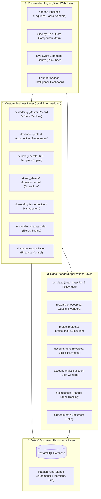
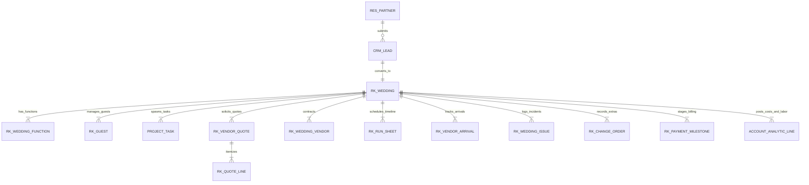
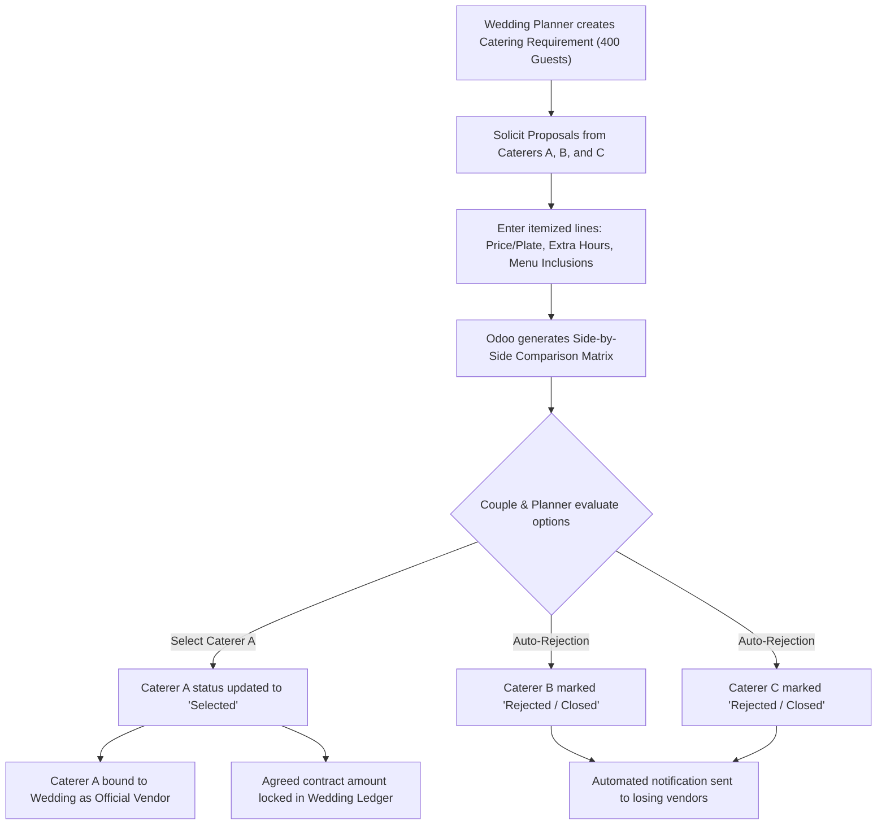
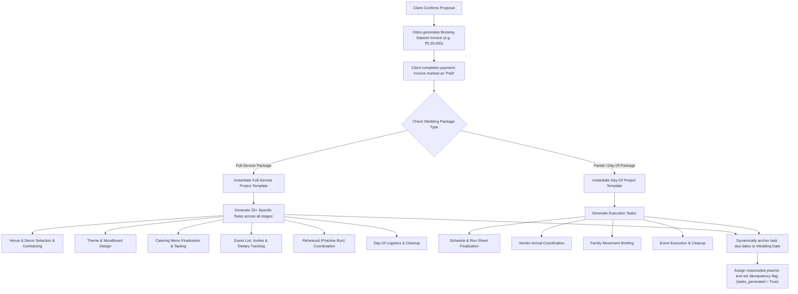
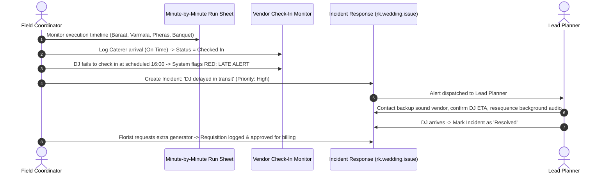
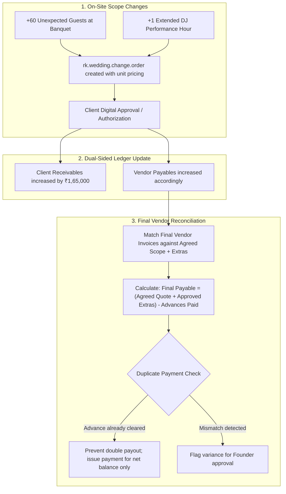
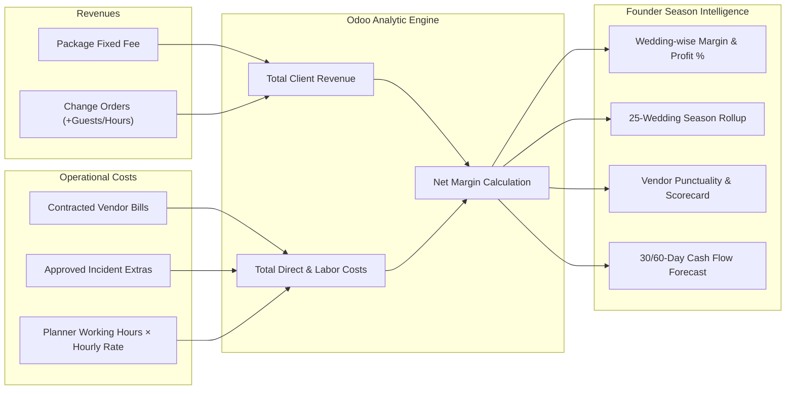

# The Royal Knot — Wedding Operations & Intelligence Platform
### *Enterprise Operations and Financial Management System for Luxury Wedding Agencies*

[](https://www.odoo.com/)
[](LICENSE)
[]()
[]()

---

## 1. System Overview

**The Royal Knot** is an enterprise management platform built specifically for high-end destination wedding agencies operating in destinations like Jaipur and Udaipur. Planning ~25 luxury multi-day weddings annually—each hosting 400+ guests, coordinating ~18 vendor categories, and managing multi-crore budgets—requires strict operational control and real-time financial tracking.

Rather than a disjointed checklist tool, the platform acts as the core operational and financial backbone, providing unified visibility from initial client enquiry through contract execution, day-of operations, change order approvals, and final vendor reconciliation to season-level profitability analysis.

```
Enquiry ──► Digital Agreement ──► Quote Comparison ──► Auto-Planning ──► Command Centre ──► Reconciliation ──► Season Profit
```

---

## 2. System Architecture

The solution is implemented as a native Odoo add-on module (`royal_knot_wedding`), extending standard Odoo core applications rather than maintaining duplicate subsystems.

### 2.1 High-Level Tiered Architecture



---

### 2.2 Data Architecture & Entity Relationships

The data model unifies operational events and financial obligations under the central `rk.wedding` record, which binds to Odoo's native CRM, Project, and Accounting models.



### 2.3 Model Definitions & Responsibilities

| Model Identifier | Primary Responsibility | Native Odoo Integration |
| :--- | :--- | :--- |
| `rk.wedding` | Master wedding lifecycle, package type, budget, dates, state transitions, financial rollup | Linked to `crm.lead`, `account.analytic.account` |
| `rk.wedding.function` | Multi-day sub-events (Mehendi, Sangeet, Haldi, Varmala, Reception) | Categorizes tasks, vendors, and run sheets |
| `rk.vendor.quote` | Header for multi-vendor proposals with status tracking (`draft`, `submitted`, `selected`, `rejected`) | Inherits from or links to `res.partner` (vendor) |
| `rk.quote.line` | Granular quotation line items (price per plate, extra-hour rates, inclusions) | Standardized unit metrics for side-by-side comparison |
| `rk.wedding.vendor` | Contracted vendors per function; tracks baseline cost, advances disbursed, and remaining dues | Generates `account.move` (vendor bills) |
| `rk.guest` | Guest list tracking: RSVP, dietary requirements (Jain, Vegan, Non-Veg), and function attendance | Links to `res.partner` |
| `rk.venue.layout` | Spatial zone management, seating arrangements, and floor plan file attachments | Integrated with `ir.attachment` |
| `rk.run_sheet` | Chronological minute-by-minute execution run sheet | Grouped by function; references assigned planners |
| `rk.vendor.arrival` | Live vendor check-in monitor (expected vs. actual arrival) with late detection logic | Generates real-time alerts in `rk.wedding` |
| `rk.wedding.issue` | Event-day incident logging, priority scoring, planner assignment, and resolution tracking | Mail thread & chatter enabled |
| `rk.family.movement` | VIP and family coordination protocols (movement between suites, mandap, dining) | Operational cues linked to run sheet timeline |
| `rk.wedding.change.order`| Scope additions (+guests, +DJ hours, +generators) with client approval workflow | Feeds customer invoices and vendor payable adjustments |
| `rk.payment.milestone` | 3-stage payment plan (Booking Deposit, Advance, Final Balance) | Synchronized with `account.move` customer invoices |

---

## 3. Core System Workflows

### 3.1 Enquiry Capture & Agreement Gating Workflow

Guarantees that high-intent leads are captured with complete event specifications and enforces legal compliance before releasing confidential vendor lists or layout designs.

```mermaid
sequenceDiagram
    autonumber
    actor Couple
    actor Planner
    participant CRM as CRM / Enquiry (crm.lead)
    participant Wedding as Wedding Record (rk.wedding)
    participant Sign as Digital Agreement (sign.request)
    participant Catalog as Vendor Directory & Layouts

    Couple->>CRM: Submit enquiry (Date, Jaipur, 400 Guests, Budget, Heritage Theme)
    CRM->>Planner: Auto-assign lead & schedule first consultation
    Planner->>Wedding: Convert qualified Lead to Wedding record
    Wedding->>Sign: Generate standard Service Agreement with payment terms
    Sign->>Couple: Deliver agreement via mobile/email link for digital signature
    Couple->>Sign: E-signs agreement
    Sign->>Wedding: Attach signed PDF; set agreement_signed = True
    Note over Wedding,Catalog: Security Gate: Catalog & Layouts unlocked only when agreement_signed = True
    Planner->>Catalog: Access vendor shortlists and floor plan designer
```

---

### 3.2 3-Way Vendor Procurement & Quote Comparison Workflow

Standardizes inconsistent vendor proposals into an itemized comparison matrix, with automated closure of non-selected bids.



---

### 3.3 Instant Automated Wedding Planning Workflow

Eliminates manual checklist re-creation by generating package-specific task trees upon confirmed booking deposit payment.



---

### 3.4 Wedding-Day Command Centre & Live Incident Workflow

Provides field coordinators with real-time operational execution tools, monitoring vendor punctuality and tracking live issue resolutions.



---

### 3.5 Change Order, Vendor Settlement & Anti-Duplicate Reconciliation Workflow

Maintains financial integrity when on-site event scopes change, ensuring clients are billed fairly and vendor disbursements are netted accurately against advances.



---

### 3.6 Founder Season Profitability & Intelligence Workflow

Calculates actual accounting profit per wedding by combining client revenue, direct vendor expenses, event-day extras, and internal planner labor timesheets.

$$\mathbf{True\ Wedding\ Profit} = \mathbf{Invoiced\ Revenue} - \left(\mathbf{Vendor\ Final\ Bills} + \mathbf{Approved\ Direct\ Extras} + \mathbf{Planner\ Timesheet\ Labor}\right)$$



---

## 4. Package Differentiation: Full-Service vs. Partial / Day-Of

The platform treats Full-Service and Day-Of packages as distinct operational lifecycles sharing a unified data model:

```mermaid
flowchart TD
    subgraph Full_Service_Workflow["Full-Service Wedding Lifecycle (End-to-End Planning)"]
        FS1["Enquiry & Consultation"] --> FS2["Digital Service Agreement"]
        FS2 --> FS3["Theme, Moodboard & Spatial Design"]
        FS3 --> FS4["Venue Booking & Layout Planning"]
        FS4 --> FS5["Multi-Vendor Procurement & Selection"]
        FS5 --> FS6["Guest List, Invitations & Dietary Matrix"]
        FS6 --> FS7["Ceremony Rehearsal (Practice Run)"]
        FS7 --> FS8["Day-Of Command Centre Execution"]
        FS8 --> FS9["Site Clearance & Cleanup Coordination"]
        FS9 --> FS10["Final Vendor Settlement & Season Profit Analysis"]
    end

    subgraph Day_Of_Workflow["Partial / Day-Of Lifecycle (Event Coordination)"]
        DO1["Enquiry & Consultation"] --> DO2["Day-Of Service Agreement"]
        DO2 --> DO3["Client-Provided Schedule Intake"]
        DO3 --> DO4["Vendor Contact & Arrival Briefing"]
        DO4 --> DO5["Minute-by-Minute Run Sheet Finalization"]
        DO5 --> DO6["Family & VIP Movement Protocol Assignment"]
        DO6 --> DO7["Day-Of Command Centre & Incident Resolution"]
        DO7 --> DO8["Site Clearance & Cleanup Verification"]
        DO8 --> DO9["Final Scope Adjustment & Financial Reconciliation"]
    end
```



---

## 5. Technology Stack

| Layer | Component | Specification | Description & Role |
| :--- | :--- | :--- | :--- |
| **Platform** | **Odoo ERP** | Version 17.0 / 18.0 (CE & EE) | Modular ERP backbone providing user management, ORM, and base apps |
| **Backend** | **Python** | Python 3.10+ | Business logic, state machines, automated actions, and reconciliation algorithms |
| **Database** | **PostgreSQL** | PostgreSQL 14+ | Relational data persistence, foreign key integrity, and transactional indexing |
| **ORM** | **Odoo ORM** | Native Python ORM | High-level data models, computed fields, domain filtering, and record constraints |
| **Frontend** | **Odoo Web Client** | XML, QWeb, Jinja2, SCSS | Responsive Forms, Lists, Kanbans, Calendars, and Pivot Views |
| **Interactive UI**| **OWL** | Odoo Web Library (OWL 2.0) | Custom reactive components (Side-by-side Quote Matrix, Run Sheet Cockpit) |
| **Security** | **Odoo Access Rules**| `ir.model.access.csv` + Record Rules | Role-Based Access Control (Planner, Field Coordinator, Finance, Founder) |
| **Documents** | **Attachment Engine**| `ir.attachment` | Storage for signed PDFs, floorplans, vendor invoices, and photo records |
| **Audit & Log** | **Mail Thread** | `mail.thread`, `mail.activity.mixin` | Full audit trail and chatter logging on all quote, contract, and financial changes |
| **Tax Engine** | **Indian Accounting**| GST (18%) / CGST, SGST, IGST | Standard tax structures for catering and event management services |

---

## 6. Custom Module Layout (`royal_knot_wedding`)

```text
royal_knot_wedding/
├── __init__.py
├── __manifest__.py
├── models/
│   ├── __init__.py
│   ├── rk_wedding.py             # Wedding lifecycle master & state engine
│   ├── rk_wedding_function.py    # Sub-events (Mehendi, Sangeet, Haldi, etc.)
│   ├── rk_vendor_quote.py        # RFQ comparison engine & auto-closure
│   ├── rk_quote_line.py          # Line-item pricing, plate costs, extras
│   ├── rk_wedding_vendor.py      # Contracted vendor records & accounts
│   ├── rk_guest.py               # Guest list, RSVP & dietary matrices
│   ├── rk_venue_layout.py        # Spatial layouts & floorplan attachments
│   ├── rk_rehearsal.py           # Practice-run coordination & cue notes
│   ├── rk_run_sheet.py           # Minute-by-minute execution timeline
│   ├── rk_vendor_arrival.py      # Vendor check-in & late detection logic
│   ├── rk_wedding_issue.py       # Live event incident tracking & resolution
│   ├── rk_family_movement.py     # Family & VIP movement instructions
│   ├── rk_change_order.py        # Extras engine (+60 guests, extra hours)
│   ├── rk_payment_milestone.py   # 3-stage billing (Deposit, Advance, Final)
│   └── rk_team_timesheet.py      # Planner labor tracking & cost allocation
├── views/
│   ├── wedding_views.xml         # Master form, tree, kanban, and search views
│   ├── vendor_views.xml          # Vendor directory & Quote Comparison Matrix
│   ├── planning_views.xml        # Guest, Layout, and Rehearsal views
│   ├── operations_views.xml      # Run Sheet, Check-in monitor, Incident board
│   ├── finance_views.xml         # Change orders, bills, milestones & reconciliation
│   ├── dashboard_views.xml       # Founder Season Intelligence dashboard
│   └── menus.xml                 # Hierarchical navigation menu structure
├── security/
│   ├── security.xml              # User groups (Planner, Coordinator, Finance, Founder)
│   └── ir.model.access.csv       # Access permissions per role
├── data/
│   ├── task_templates.xml        # 25+ automated task templates (Full vs Day-Of)
│   └── sequence.xml              # Sequence identifiers (WED/2026/001, etc.)
└── demo/
    └── demo_data.xml             # Complete demo dataset (400-guest Jaipur wedding)
```

---

## 7. Installation & Deployment

### 7.1 Clone into Odoo Add-ons Directory
```bash
cd /path/to/odoo/custom_addons
git clone https://github.com/pavankarthikeyaatchyuta-lab/ODOO_Finals.git royal_knot_wedding
```

### 7.2 Update Configuration
Add the custom addons path to your `odoo.conf`:
```ini
addons_path = /path/to/odoo/addons,/path/to/odoo/custom_addons
```

### 7.3 Install Module
1. Restart the Odoo service:
   ```bash
   python3 odoo-bin -c odoo.conf -u royal_knot_wedding -d royal_knot_db
   ```
2. In the Odoo Web Client, activate **Developer Mode**.
3. Navigate to **Apps** $\rightarrow$ **Update Apps List**.
4. Search for `The Royal Knot` and click **Activate**.
