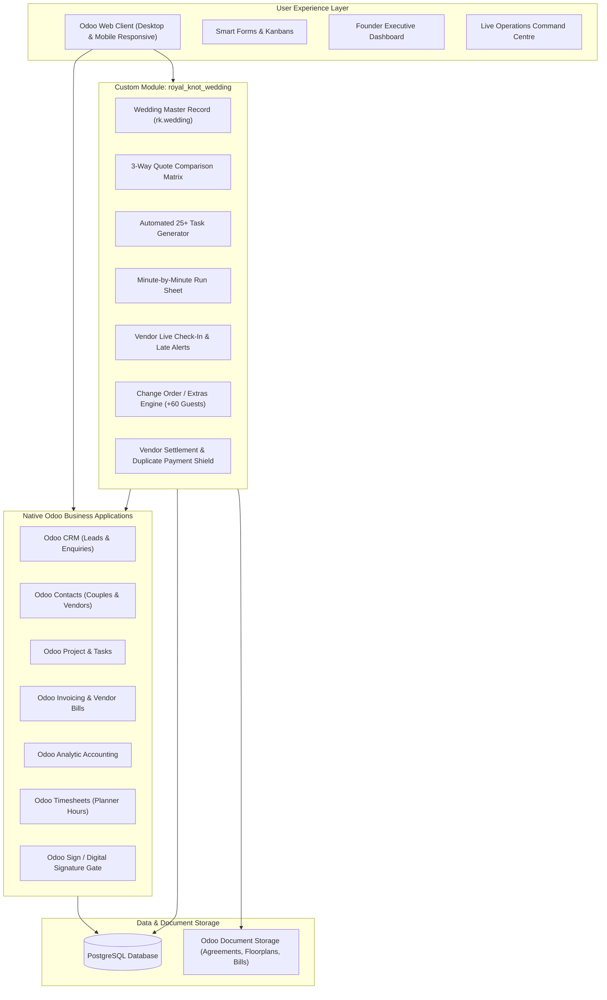

# 👑 The Royal Knot — Wedding Operations & Intelligence Platform
### *The Digital Backbone for Luxury Destination Wedding Planning*
**Odoo × GCET Hackathon Finals — Official Implementation Repository**

[](https://www.odoo.com/)
[](LICENSE)
[]()
[]()

> *"One connected platform. Every wedding. Every vendor. Every payment. Every decision."*

---

## 📌 Executive Summary

**The Royal Knot** is a premier luxury wedding planning agency operating across **Jaipur and Udaipur**. Every season, the agency produces approximately **25 high-end, three-day destination weddings**, each hosting **400+ guests**, coordinating **~18 distinct vendor categories** (decorators, royal caterers, makeup artists, folk artists, pyrotechnics, drummers), and managing budgets exceeding **multiple crores per event**.

Today, agency operations suffer from extreme fragmentation:
* High-intent client enquiries arrive on Instagram, WhatsApp, and phone calls—and slip through the cracks.
* Vendor quotes arrive as unstandardized PDFs in chaotic WhatsApp chats and are compared manually.
* Wedding checklists are maintained in physical diaries and rewritten from scratch for every event.
* Client advances and vendor stage-payments are tracked in notebooks, risking duplicate payouts or missed dues.
* True profitability per wedding is unknown until months after the season wraps up.

### The Solution
We are not building another generic wedding checklist app. We have engineered **The Royal Knot Wedding Operations & Intelligence Platform**—a comprehensive, multi-tiered enterprise management system built natively as an **Odoo add-on module (`royal_knot_wedding`)**. It unifies the entire wedding lifecycle into one interconnected operational and financial ecosystem:

$$\text{Enquiry} \longrightarrow \text{Signed Agreement} \longrightarrow \text{Vendor Procurement} \longrightarrow \text{Instant Plan} \longrightarrow \text{Command Centre} \longrightarrow \text{Reconciliation} \longrightarrow \text{Season Profitability}$$

---

## 🏛️ System Architecture

Built natively on the **Odoo Multi-Tier Framework**, combining Odoo's Python ORM backend, PostgreSQL storage, XML/QWeb views, and OWL (Odoo Web Library) components.



---

## 🎯 The 6 Core Hackathon Scenarios & Implementation

Our solution directly implements the 6 mandatory operational scenes from the official brief:

### 1. The First Consultation & Digital Agreement Gate
* **Lead Capture**: Captures couple details, contact, wedding date, expected guest count (e.g., 400), themes (*Royal Heritage*, *Palace Royalty*, *Beach Chic*), and maximum budget.
* **Service Agreement Generation**: One-click generation of the standardized agency agreement populated with contract deliverables and payment schedules.
* **The Hard Access Control Gate**: **Strict Security Rule:** Planners cannot share vendor recommendations, quotes, or floor plans until the agreement status flips to `Signed` (verified via digital e-signature or uploaded signed PDF).

### 2. Three Caterers, One Decision (Side-by-Side Comparison)
* **Standardized RFQ Entry**: Solicits quotations for 400 guests with itemized breakdown:
  * Price per plate (e.g., Caterer A: ₹1,800 | Caterer B: ₹1,600 | Caterer C: ₹1,500)
  * Regional menu inclusions & tasting details
  * Extra-hour service charges & additional buffet counters
* **Comparison Matrix**: Multi-column comparison view showing line-by-line deliverables and normalized per-plate pricing side-by-side.
* **Automated Selection Logic**: Upon clicking **"Select Winning Caterer"**, the chosen vendor is automatically bound to the wedding function, locks the agreed price, and auto-closes/rejects the competing quotations.

### 3. The Instant Wedding Plan (25+ Automated Tasks)
* **Trigger**: Proposal marked *Confirmed* + Booking Deposit payment posted.
* **Package-Aware Task Generation**:
  * **Full-Service Package**: Generates **25+ structured tasks** spanning Venue, Design & Decor, Vendor Contracting, Guest Logistics, Rehearsal, and Day-of Coordination across functions (*Mehendi, Sangeet, Haldi, Varmala, Pheras, Reception*).
  * **Partial / Day-of Package**: Generates execution-focused task workflows (Schedule finalization, vendor arrival verification, family movement coordination, post-event clearance).
* **Automated Scheduling**: All task deadlines dynamically anchor to the wedding date.
* **Idempotency Safeguard**: Re-triggering or re-saving prevents duplicate task creation.

### 4. The Big Day Command Centre (Live Minute-by-Minute Run Sheet)
* **Chronological Run Sheet**: High-visibility execution timeline (e.g., *16:00 Baraat Arrival*, *18:30 Varmala*, *20:00 Pheras*, *21:30 Royal Banquet*).
* **Vendor Check-In Cockpit**: Field coordinators mark vendor arrivals. If actual time > expected arrival time, the row auto-flags in **Red (LATE ALERT)**.
* **Live Incident Management (`rk.wedding.issue`)**:
  * *Incident 1 (DJ Delayed)*: Assign to coordinator $\rightarrow$ track ETA $\rightarrow$ mark Resolved.
  * *Incident 2 (Florist extra generator)*: Raise urgent equipment requisition $\rightarrow$ tag vendor $\rightarrow$ route for billing.
  * *Incident 3 (Bride's procession vehicle stuck)*: Real-time route rerouting & sequence adjustment.

### 5. Paying Vendors, Approved Extras & Reconciliation
* **Change Order Management (`rk.wedding.change.order`)**:
  * Captures real-time event scope changes: e.g., **+60 unexpected banquet guests** (@ ₹2,500/plate) and **+1 extended DJ hour** (@ ₹15,000).
  * Client approval workflow: Updates expected client billing (₹1,50,000 + ₹15,000) and adjustments to vendor final payables.
* **Vendor Advance & Settlement Engine**:
  * Tracks individual vendor advance disbursements (e.g., ₹3,00,000 advance against Caterer A's quote).
  * Reconciles final invoice:
    $$\text{Final Payable} = (\text{Agreed Contract Amount} + \text{Approved Change Orders}) - \text{Advances Already Disbursed}$$
  * **Duplicate Payment Protection**: Prevents double payouts against the same milestone or bill.

### 6. The Founder's Season Review & True Profitability Dashboard
* **The True Profit Formula**:
  $$\mathbf{Wedding\ Profit} = \mathbf{Client\ Revenue} - (\mathbf{Vendor\ Costs} + \mathbf{Direct\ Extras} + \mathbf{Team\ Labour\ Hours})$$
* **Season-Wide Overview**: Real-time aggregation across all **25 season weddings**.
* **Vendor Reliability Scorecard**: Ratings based on punctuality, incident count, and budget adherence.
* **Cashflow Forecast**: Visual timeline of upcoming client receivables and vendor settlement dues for the next 30/60 days.

---

## 📦 Data Model & Relationships


### Model Specifications

| Model Technical Name | Purpose & Business Logic |
| :--- | :--- |
| `rk.wedding` | Central wedding entity: client, dates, package (Full vs Day-of), budget, theme, state machine, financial rollups. |
| `rk.wedding.function` | Sub-events: Mehendi, Sangeet, Haldi, Wedding Ceremony, Reception with dedicated timings & venues. |
| `rk.vendor.quote` | Quotation header with status (`draft`, `submitted`, `selected`, `rejected`), vendor link, and total computations. |
| `rk.quote.line` | Quote line items: unit price, guest count, extra charges, inclusions, and terms. |
| `rk.wedding.vendor` | Assigned vendor record per function with contracted cost, advances paid, extras, and remaining balance. |
| `rk.guest` | Guest directory: family grouping, RSVP status, function attendance, and dietary preferences (Jain, Vegan, Non-Veg). |
| `rk.venue.layout` | Spatial & zone management: banquet layouts, mandap arrangements, seating plans, and floor plan attachments. |
| `rk.rehearsal` | Practice-run coordinator: rehearsal schedule, participant checklist, and cue notes. |
| `rk.run_sheet` | Minute-by-minute execution timeline with function tags, responsible planner, and live status. |
| `rk.vendor.arrival` | Check-in monitor: expected vs. actual arrival, contact on site, and automated late detection. |
| `rk.wedding.issue` | Live incident response: severity, reporter, owner, corrective action, and resolution log. |
| `rk.family.movement` | VIP / Family protocol cues: movement triggers between suites, mandap, photo stage, and dining. |
| `rk.wedding.change.order` | Change orders for scope additions (+guests, +hours, +equipment) with client authorization and ledger updates. |
| `rk.payment.milestone` | 3-stage billing plan (Booking, 1-Month Advance, Final Settlement) synchronized with customer invoices. |

---

## 💎 Package Differentiation Matrix

| Operational Capability | Full-Service Wedding Package | Partial / Day-Of Wedding Package |
| :--- | :---: | :---: |
| **Theme & Design Moodboard** | ✅ Full Scope | ❌ Client Provided |
| **Venue Booking & Contracting** | ✅ Full Scope | ❌ Client Provided |
| **Multi-Vendor RFQ & Comparison** | ✅ Full Scope (18+ categories) | ❌ Pre-contracted by Client |
| **Floor Plan & Spatial Planning** | ✅ Full Scope | ❌ Layout Review Only |
| **Guest RSVP & Dietary Tracking** | ✅ Full Scope | ⚠️ Final Headcount Only |
| **Rehearsal & Practice Run** | ✅ Full Scope | ❌ Not Included |
| **Live Run Sheet & Command Centre**| ✅ Full Scope | ✅ Full Scope |
| **Vendor Arrival & Late Alerting** | ✅ Full Scope | ✅ Full Scope |
| **Family Movement Protocol** | ✅ Full Scope | ✅ Full Scope |
| **Change Orders & Extra Guests** | ✅ Full Scope | ✅ Full Scope |
| **Post-Event Vendor Reconciliation**| ✅ Full Scope | ✅ Full Scope |
| **Automated Tasks Generated** | **25+ End-to-End Tasks** | **8–10 Execution Tasks** |

---

## 🇮🇳 Indian Luxury Wedding Context & Edge Cases Handled

1. **Massive Scale & High Guest Volatility**:
   * Pre-built handling for unexpected last-minute arrivals (e.g., the 60 extra guests scenario) with instant headcount re-calculation across catering and seating.
2. **Strict Dietary Categorization**:
   * Granular dietary preferences tracked on `rk.guest` (Strict Jain, Pure Vegetarian, Halal, Vegan, Nut Allergies) feeding directly into catering requirements.
3. **Multi-Ceremony Multi-Day Logistics**:
   * Each wedding natively supports isolated sub-events (Haldi, Mehendi, Sangeet, Baraat, Pheras, Reception) with individual vendors, run sheets, and layout plans.
4. **Statutory & Tax Compliance (GST & TDS)**:
   * Native mapping to Indian GST rates (18% for event management and catering services) with proper CGST/SGST/IGST separation and payment stage deduction tracking.
5. **Multi-Family Coordination**:
   * Dedicated `rk.family.movement` module ensures critical VIP movements (e.g., groom family departure, bride entrance, transition to mandap) occur without confusion.

---

## 📊 Competitive Landscape: Why Odoo Wins

| Feature / Dimension | Prismm (Cvent) | Aisle Planner | WeddingWire / The Knot | **The Royal Knot (Odoo Native)** |
| :--- | :---: | :---: | :---: | :---: |
| **Architecture** | Point Solution (Floorplans) | Standalone SaaS | Consumer Marketplace | **Full Enterprise ERP Backbone** |
| **Side-by-Side Quote Matrix** | ❌ No | ⚠️ Basic | ❌ No | ✅ **Full Itemized Matrix & Auto-Close** |
| **Dynamic Task Generation** | ⚠️ Generic Checklist | ⚠️ Static Templates | ⚠️ Manual List | ✅ **Deposit-Triggered 25+ Auto Plan** |
| **Live Command Centre & Check-In** | ❌ No | ⚠️ PDF Timeline | ❌ No | ✅ **Real-Time Run Sheet & Late Alerts** |
| **Change Order Financial Impact** | ❌ No | ⚠️ Budget Field | ❌ No | ✅ **Dual-Sided (Client/Vendor) Ledger** |
| **Vendor Settlement & Advances** | ❌ No | ⚠️ Payment Tracker | ❌ No | ✅ **Reconciliation & Anti-Duplicate Shield** |
| **Planner Labor Timesheet Cost** | ❌ No | ❌ No | ❌ No | ✅ **Native Analytic Accounting** |
| **Founder Profit Intelligence** | ❌ No | ⚠️ Basic Cash Flow | ❌ No | ✅ **True Multi-Wedding Margin KPI** |

---

## 🗂️ Module Directory Layout

```text
royal_knot_wedding/
├── __init__.py
├── __manifest__.py
├── models/
│   ├── __init__.py
│   ├── rk_wedding.py             # Main wedding lifecycle & state machine
│   ├── rk_wedding_function.py    # Sub-events (Mehendi, Sangeet, etc.)
│   ├── rk_vendor_quote.py        # RFQ comparison engine
│   ├── rk_quote_line.py          # Itemized quote breakdown
│   ├── rk_wedding_vendor.py      # Contracted vendors & ledger
│   ├── rk_guest.py               # Guest list, RSVP & dietary matrix
│   ├── rk_venue_layout.py        # Spatial layouts & floorplans
│   ├── rk_rehearsal.py           # Practice-run coordinator
│   ├── rk_run_sheet.py           # Minute-by-minute execution timeline
│   ├── rk_vendor_arrival.py      # Check-in monitor & late alert logic
│   ├── rk_wedding_issue.py       # Live event incident management
│   ├── rk_family_movement.py     # Family & VIP movement cues
│   ├── rk_change_order.py        # Change order engine (+guests, +hours)
│   ├── rk_payment_milestone.py   # 3-stage billing milestones
│   └── rk_team_timesheet.py      # Planner labor tracking
├── views/
│   ├── wedding_views.xml         # Form, List, Kanban & Search views
│   ├── vendor_views.xml          # Directory & Quote Comparison Matrix
│   ├── planning_views.xml        # Guest, Layout & Rehearsal views
│   ├── operations_views.xml      # Run Sheet, Check-in & Issue Tracker
│   ├── finance_views.xml         # Change Orders, Bills & Milestones
│   ├── dashboard_views.xml       # Founder Season Intelligence Dashboard
│   └── menus.xml                 # Consolidated App Menu hierarchy
├── security/
│   ├── security.xml              # User Groups (Planner, Coordinator, Finance, Founder)
│   └── ir.model.access.csv       # Granular Access Control Rules
├── data/
│   ├── task_templates.xml        # 25+ Pre-seeded Full/Day-of tasks
│   └── sequence.xml              # Sequence numbers (WED/2026/001, etc.)
├── demo/
│   └── demo_data.xml             # Rich demo scenario (Rahul & Ananya 400-guest wedding)
└── static/
    └── description/
        ├── icon.png              # App icon
        └── banner.png            # Module banner
```

---

## 🚀 Installation & Quickstart

### Prerequisites
* **Odoo**: Version 17.0 or 18.0 (Community or Enterprise)
* **Python**: 3.10+
* **PostgreSQL**: 14+
* **Dependencies**: `crm`, `project`, `account`, `hr_timesheet`, `contacts`

### Setup Instructions
1. Clone this repository into your Odoo custom addons path:
   ```bash
   cd /path/to/odoo/custom_addons
   git clone https://github.com/pavankarthikeyaatchyuta-lab/ODOO_Finals.git royal_knot_wedding
   ```
2. Update your Odoo configuration file (`odoo.conf`):
   ```ini
   addons_path = /path/to/odoo/addons,/path/to/odoo/custom_addons
   ```
3. Restart your Odoo server and enable developer mode in the web client.
4. Navigate to **Apps** $\rightarrow$ **Update Apps List**.
5. Search for `The Royal Knot Wedding Management` and click **Activate**.
6. (Optional) Install demo data to immediately inspect the pre-seeded **Rahul & Ananya Udaipur Wedding**.

---

## 🎬 3-Minute Demo Walkthrough Script

| Step | Screen | Action & Live Demonstration |
| :---: | :--- | :--- |
| **1** | **CRM Pipeline** | Open enquiry for *Rahul & Ananya* (400 guests, Udaipur, Heritage Theme, ₹3.5 Cr budget). Show digital agreement generation and demonstrate that vendor lists remain **gated/locked** until the agreement is signed. |
| **2** | **Quote Matrix** | Navigate to Catering RFQs. Compare Caterers A, B, and C side-by-side. Click **Select Winner** on Caterer A: demonstrate that Caterers B and C auto-close as *Rejected* and Caterer A binds to the wedding. |
| **3** | **Instant Plan** | Confirm proposal and post ₹5,00,000 booking deposit. Switch to **Tasks**: show **25+ structured tasks** automatically spawned with owners and function tags. |
| **4** | **Command Centre**| Open the **Event Day Run Sheet**. Perform live vendor check-in; mark the DJ delayed to trigger the **Red Late Alert**. Create an incident ticket (*DJ delayed*), assign to planner, and resolve it. |
| **5** | **Change Orders** | Add approved change order: **60 Extra Banquet Guests** (@ ₹2,500) and **1 Extra DJ Hour** (₹15,000). Show updated client invoice and final vendor settlement with advance deducted. |
| **6** | **Founder Dashboard**| Open **Season Intelligence**. Highlight overall margin, net profit calculation (Revenue − Vendor bills − Planner labor), upcoming dues, and vendor reliability scorecard. |

---

## 👥 Contributors & Hackathon Team
* **Team**: GCET Hackathon Finalists
* **Project**: The Royal Knot — Wedding Operations & Intelligence Platform
* **Repository**: [pavankarthikeyaatchyuta-lab/ODOO_Finals](https://github.com/pavankarthikeyaatchyuta-lab/ODOO_Finals)
