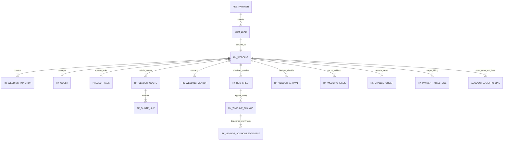
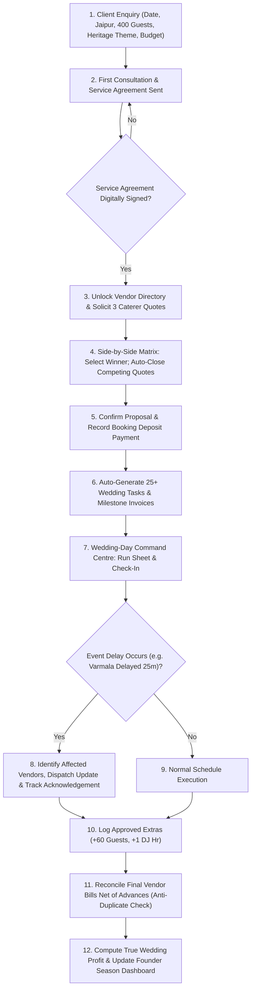
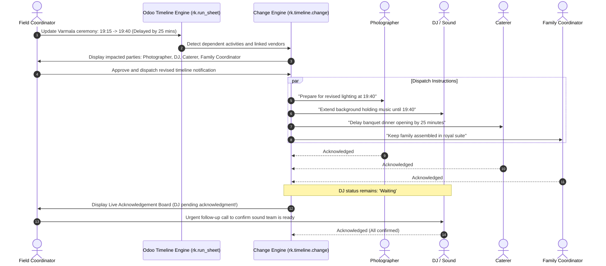
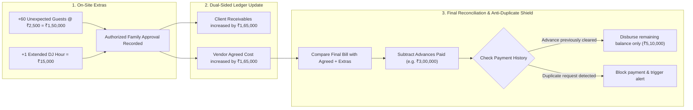

# The Royal Knot — Wedding Operations & Intelligence Platform
### *Enterprise Operations and Financial Management System for Luxury Wedding Agencies*

[](https://www.odoo.com/)
[](LICENSE)
[]()
[]()

---

## 1. Executive Summary & Problem Statement

**The Royal Knot** is a premier luxury wedding planning agency operating in **Jaipur and Udaipur**. Every season, the agency plans approximately **25 luxury three-day destination weddings**, each hosting **400+ guests**, managing **~18 vendor categories** (decorators, royal caterers, drummers, makeup artists, lighting, sound), and handling multi-crore budgets.

### 1.1 The Operational Challenge
Currently, operations are fragmented across WhatsApp chats, unstandardized PDF quotations, phone calls, paper diaries, and notebooks:
* **Client Enquiries**: Enquiries from Instagram, WhatsApp, and calls are easily lost without a central CRM.
* **Vendor Quotations**: Competing vendor bids (menus, plate costs, extra-hour rates) are compared manually across different PDF files.
* **Wedding Planning**: Checklists are maintained in physical diaries and manually rewritten for every wedding.
* **Payments & Advances**: Advance disbursements (~15 vendors per wedding) and client milestones are tracked in notebooks, risking missed dues or duplicate payouts.
* **Profit Visibility**: True profitability per wedding is unknown until months after the season wraps up.

### 1.2 Core Architectural Philosophy
The Royal Knot is not another generic wedding checklist app. It is a unified enterprise operations and financial management system built natively as an Odoo add-on (`royal_knot_wedding`). It anchors the entire agency lifecycle into **One Connected Wedding Record**:

$$\text{Enquiry} \longrightarrow \text{Digital Agreement} \longrightarrow \text{Vendor Procurement} \longrightarrow \text{Instant 25+ Plan} \longrightarrow \text{Live Command Centre} \longrightarrow \text{Timeline Change & Ack} \longrightarrow \text{Reconciliation} \longrightarrow \text{Season Profit}$$

---

## 2. System Architecture

The application is engineered as a native Odoo module extending standard business apps rather than reinventing generic CRM, accounting, and task engines.

### 2.1 Multi-Tiered System Architecture

```mermaid
flowchart TD
    subgraph Presentation_Layer["1. Presentation Layer (Odoo Web Client & Mobile)"]
        UI_Kanban["Enquiry & Task Kanban Boards"]
        UI_Compare["3-Way Quote Comparison Matrix"]
        UI_Command["Live Event Command Centre Cockpit"]
        UI_Ack["Vendor Change Acknowledgement Dashboard"]
        UI_Dashboard["Founder Season Intelligence Dashboard"]
    end

    subgraph Custom_Business_Layer["2. Custom Business Layer (royal_knot_wedding)"]
        M_Wedding["rk.wedding (Master Lifecycle & State Engine)"]
        M_Quotes["rk.vendor.quote & rk.quote.line (Procurement)"]
        M_PlanGen["rk.task.generator (25+ Template Engine)"]
        M_RunSheet["rk.run_sheet (Minute-by-Minute Schedule)"]
        M_Arrival["rk.vendor.arrival (Check-In & Late Detection)"]
        M_ChangeAck["rk.timeline.change & rk.vendor.acknowledgement"]
        M_Issues["rk.wedding.issue (Live Incident Tracker)"]
        M_ChangeOrder["rk.wedding.change.order (Extras Engine)"]
        M_Reconcile["rk.vendor.reconciliation (Financial Settlement)"]
    end

    subgraph Odoo_Core_Apps["3. Odoo Standard Applications Layer"]
        App_CRM["crm.lead (Lead Ingestion & Pipeline Stages)"]
        App_Contacts["res.partner (Couples, Vendors & Guests)"]
        App_Project["project.project & project.task (Execution Engine)"]
        App_Account["account.move (Client Invoices & Vendor Bills)"]
        App_Analytic["account.analytic.account (Cost Centers)"]
        App_Timesheet["hr.timesheet (Planner Labor Tracking)"]
        App_Sign["sign.request / Attachment Gating"]
    end

    subgraph Persistence_Layer["4. Data & Document Persistence Layer"]
        DB[(PostgreSQL Database)]
        DocStore["ir.attachment (Agreements, Floorplans, Bills)"]
    end

    Presentation_Layer --> Custom_Business_Layer
    Presentation_Layer --> Odoo_Core_Apps
    Custom_Business_Layer <--> Odoo_Core_Apps
    Custom_Business_Layer --> Persistence_Layer
    Odoo_Core_Apps --> Persistence_Layer
```



---

### 2.2 Data Architecture & Entity Relationship Diagram (ERD)



---

### 2.3 Model Technical Specifications & Responsibilities

| Technical Model Name | Responsibility & Business Logic | Native Odoo Integration |
| :--- | :--- | :--- |
| `rk.wedding` | Master wedding record: couple reference, package type, dates, budget, state machine, financial rollup | Linked to `crm.lead`, `account.analytic.account` |
| `rk.wedding.function` | Sub-events (Mehendi, Sangeet, Haldi, Varmala, Pheras, Reception) with dedicated timings and venues | Categorizes tasks, vendors, and run sheets |
| `rk.vendor.quote` | Vendor quotation header with states (`draft`, `submitted`, `selected`, `rejected`) and total computations | Links to `res.partner` (Vendor) |
| `rk.quote.line` | Granular quotation items (price per plate, extra-hour charges, inclusions/exclusions) | Standardized unit metrics for comparison |
| `rk.wedding.vendor` | Assigned vendor record per function; tracks baseline contract cost, advances, extras, and net balance | Generates `account.move` (vendor bills) |
| `rk.guest` | Guest list directory: family grouping, RSVP status, dietary preferences (Jain, Vegan, Non-Veg) | Links to `res.partner` |
| `rk.venue.layout` | Spatial zone management, seating configurations, and floor plan file attachments | Integrated with `ir.attachment` |
| `rk.run_sheet` | Chronological minute-by-minute execution run sheet with function tags and responsible staff | References planners and vendors |
| `rk.vendor.arrival` | Vendor check-in cockpit (expected vs. actual arrival) with automated late flagging | Updates live dashboard alerts |
| `rk.timeline.change` | Real-time event delay or schedule revision engine | Links to `rk.run_sheet` and affected activities |
| `rk.vendor.acknowledgement` | Dispatches revised schedule instructions to affected vendors and tracks receipt status (`Waiting` vs `Acknowledged`) | Connected to mail chatter / SMS / WhatsApp |
| `rk.wedding.issue` | Event-day incident logging, priority scoring, planner assignment, and resolution tracking | Mail thread & chatter enabled |
| `rk.wedding.change.order` | Scope additions (+guests, +DJ hours, +generators) with client approval workflow | Feeds customer invoices and vendor payables |
| `rk.payment.milestone` | 3-stage billing plan (Booking Deposit, Advance, Final Balance) | Synchronized with `account.move` customer invoices |

---

## 3. The 8 Core Functional Modules

### Module 1: Client & Enquiry Management
* **Capture Channel**: Tracks leads from Instagram, WhatsApp, website, and phone calls.
* **Enquiry Fields**: Couple names, contact details, wedding date, guest count (400+), preferred theme (*Royal Heritage*, *Palace Royalty*, *Beach Chic*), maximum budget, and package type.
* **Pipeline Stages**: `New` $\longrightarrow$ `Contacted` $\longrightarrow$ `Meeting Scheduled` $\longrightarrow$ `Proposal Sent` $\longrightarrow$ `Agreement Signed` $\longrightarrow$ `Confirmed / Lost`.
* **The Agreement Gate**: Strict security rule: vendor directories, shortlists, and layout plans remain disabled/hidden until the digital service agreement is marked `Signed`.

### Module 2: Vendor & Quotation Management
* **Itemized Quotations**: Standardized RFQ inputs for price per plate, extra-hour rates, equipment inclusions, and menu items.
* **Side-by-Side Comparison Matrix**: Compares 3 vendor bids simultaneously (e.g., Caterers A, B, and C) line by line.
* **Single-Click Selection Logic**: Selecting the winning vendor automatically locks the agreed price into the wedding ledger, binds the vendor to the function, and auto-closes/rejects competing proposals.

### Module 3: Wedding Planning & Task Management
* **Trigger**: Proposal confirmed + Booking Deposit payment recorded.
* **Automated Task Generator**: Spawns **25+ structured tasks** with assigned owners and deadlines anchored to the wedding date.
* **Task Categorization**: Venue & Layout, Design & Decor, Vendor Contracting, Mehendi Prep, Sangeet Production, Reception Logistics, Day-of Execution, and Cleanup.
* **Idempotency Protection**: Safe against double-execution or re-saving.

### Module 4: Live Wedding Command Centre
* **Live Execution Timeline**: Displays current event, next event, planned time, and actual time.
* **Vendor Check-In Cockpit**: Coordinators log arrival. If current time > expected arrival time and vendor has not arrived, system triggers a **Red Late Alert**.
* **High-Visibility Statuses**: Visual badges across activities: *Completed*, *On Schedule*, *Delayed*, *Late Arrival*.

### Module 5: Timeline Changes & Vendor Acknowledgement *(Key Differentiator)*
* **Operational Delay Management**: When an event slips (e.g., *Varmala delayed by 25 minutes*), the planner logs the revised timing.
* **Impact Analysis**: The system automatically identifies all linked activities and affected vendors:
  * **Photographer**: Prepare for revised lighting and ceremony timing.
  * **DJ / Sound**: Extend holding ambient music.
  * **Caterer**: Adjust dinner buffet opening schedule.
  * **Family Coordinator**: Hold VIP family in royal suite.
* **Acknowledgement Engine**: Dispatches updated instructions and tracks confirmation in real time (`Waiting` vs. `Acknowledged`). The planner immediately spots who has not acknowledged the change.

### Module 6: Incident & Issue Management
* **Rapid Incident Logging**: Logs unexpected operational emergencies (e.g., *DJ stuck in traffic*, *Florist requires extra generator*, *Bride procession vehicle delayed*).
* **Workflow**: Captures severity, category, linked vendor, and assigned coordinator.
* **Chatter Resolution Log**: Real-time status progression (`Open` $\longrightarrow$ `In Progress` $\longrightarrow$ `Resolved`) with historical audit logs.

### Module 7: Payments, Additional Costs & Reconciliation
* **Dual Financial Streams**:
  * **Client Milestones**: Booking Deposit (at signing), Advance Payment (~1 month prior), Final Settlement (post-event).
  * **Vendor Disbursements**: Contracted quote, advances disbursed, final bill, and net payable.
* **Change Order Engine**: Captures event-day extras (e.g., **+60 unexpected guests** @ ₹2,500/plate = ₹1,50,000; **+1 extended DJ hour** = ₹15,000) with client authorization.
* **Anti-Duplicate Settlement Guard**:
  $$\text{Final Vendor Balance} = (\text{Agreed Contract Amount} + \text{Approved Extras}) - \text{Advances Already Disbursed}$$
  Prevents double-payouts against advances already cleared.

### Module 8: Founder Dashboard & Reporting
* **True Profitability Formula**:
  $$\mathbf{Wedding\ Profit} = \mathbf{Recognized\ Client\ Revenue} - \mathbf{Vendor\ Costs} - \mathbf{Approved\ Direct\ Extras} - \mathbf{Team\ Labour\ Cost}$$
* **Season Rollup**: Aggregated KPI metrics across all **25 season weddings**.
* **Cashflow Visibility**: 30/60-day visual timeline of upcoming client receivables and vendor payables.
* **Vendor Scorecard**: Tracks vendor reliability, on-time percentage, and incident counts.

---

## 4. Core System Workflows

### 4.1 End-to-End Operational Lifecycle Workflow



---

### 4.2 Timeline Delay & Vendor Acknowledgement Workflow



---

### 4.3 Change Order & Financial Reconciliation Workflow



---

## 5. Package Differentiation Workflows

| Capability | Full-Service Wedding Package | Partial / Day-Of Wedding Package |
| :--- | :---: | :---: |
| **Theme & Design Moodboard** | ✅ Full Scope | ❌ Client Provided |
| **Venue Booking & Floorplans** | ✅ Full Scope | ❌ Layout Review Only |
| **Vendor Procurement & RFQs** | ✅ Full Scope (18+ categories) | ❌ Pre-contracted by Client |
| **Guest RSVP & Dietary Tracking** | ✅ Full Scope | ⚠️ Final Headcount Only |
| **Rehearsal & Practice Run** | ✅ Full Scope | ❌ Not Included |
| **Live Command Centre & Run Sheet**| ✅ Full Scope | ✅ Full Scope |
| **Vendor Check-In & Late Alerts** | ✅ Full Scope | ✅ Full Scope |
| **Timeline Change & Acknowledgement**| ✅ Full Scope | ✅ Full Scope |
| **Change Orders & Extra Guests** | ✅ Full Scope | ✅ Full Scope |
| **Final Vendor Reconciliation** | ✅ Full Scope | ✅ Full Scope |
| **Automated Tasks Generated** | **25+ End-to-End Tasks** | **8–10 Execution Tasks** |

```mermaid
flowchart TD
    subgraph Full_Service_Workflow["Full-Service Wedding Lifecycle"]
        FS1["Enquiry & Consultation"] --> FS2["Digital Service Agreement"]
        FS2 --> FS3["Theme & Design"]
        FS3 --> FS4["Venue Booking & Layouts"]
        FS4 --> FS5["Vendor RFQ & Selection"]
        FS5 --> FS6["Guest RSVPs & Dietary Matrix"]
        FS6 --> FS7["Practice Rehearsal"]
        FS7 --> FS8["Live Command Centre Execution"]
        FS8 --> FS9["Site Clearance & Cleanup"]
        FS9 --> FS10["Final Reconciliation & Season Profit"]
    end

    subgraph Day_Of_Workflow["Partial / Day-Of Lifecycle"]
        DO1["Enquiry & Consultation"] --> DO2["Day-Of Agreement"]
        DO2 --> DO3["Client Schedule Intake"]
        DO3 --> DO4["Vendor Contact & Briefing"]
        DO4 --> DO5["Run Sheet Finalization"]
        DO5 --> DO6["Family Movement Protocol"]
        DO6 --> DO7["Live Command Centre & Incidents"]
        DO7 --> DO8["Site Clearance & Cleanup"]
        DO8 --> DO9["Final Extras Settlement"]
    end
```



---

## 6. Technology Stack & Technical Specifications

| Layer | Component | Specification | Operational Role |
| :--- | :--- | :--- | :--- |
| **Platform** | **Odoo ERP** | Version 17.0 / 18.0 (CE & EE) | Modular ERP backbone providing user management, ORM, and base apps |
| **Backend** | **Python** | Python 3.10+ | Business logic, state machines, automated actions, and reconciliation algorithms |
| **Database** | **PostgreSQL** | PostgreSQL 14+ | Relational data persistence, foreign key integrity, and transactional indexing |
| **ORM** | **Odoo ORM** | Native Python ORM | High-level data models, computed fields, domain filtering, and record constraints |
| **Frontend** | **Odoo Web Client** | XML, QWeb, Jinja2, SCSS | Responsive Forms, Lists, Kanbans, Calendars, and Pivot Views |
| **Interactive UI**| **OWL** | Odoo Web Library (OWL 2.0) | Reactive components (Side-by-side Quote Matrix, Run Sheet Cockpit, Ack Tracker) |
| **Security** | **Odoo Access Rules**| `ir.model.access.csv` + Record Rules | Role-Based Access Control (Planner, Field Coordinator, Finance, Founder) |
| **Documents** | **Attachment Engine**| `ir.attachment` | Storage for signed PDFs, floorplans, vendor invoices, and photo records |
| **Audit & Log** | **Mail Thread** | `mail.thread`, `mail.activity.mixin` | Full audit trail and chatter logging on all quote, contract, and financial changes |
| **Tax Engine** | **Indian Accounting**| GST (18%) / CGST, SGST, IGST | Standard tax structures for catering and event management services |

---

## 7. Custom Module Layout (`royal_knot_wedding`)

```text
royal_knot_wedding/
├── __init__.py
├── __manifest__.py
├── models/
│   ├── __init__.py
│   ├── rk_wedding.py             # Wedding lifecycle master & state engine
│   ├── rk_wedding_function.py    # Sub-events (Mehendi, Sangeet, Haldi, etc.)
│   ├── rk_vendor_quote.py        # RFQ comparison engine & auto-closure
│   ├── rk_quote_line.py          # Line-item pricing, plate costs, extras
│   ├── rk_wedding_vendor.py      # Contracted vendor records & accounts
│   ├── rk_guest.py               # Guest list, RSVP & dietary matrices
│   ├── rk_venue_layout.py        # Spatial layouts & floorplan attachments
│   ├── rk_rehearsal.py           # Practice-run coordination & cue notes
│   ├── rk_run_sheet.py           # Minute-by-minute execution timeline
│   ├── rk_vendor_arrival.py      # Vendor check-in & late detection logic
│   ├── rk_timeline_change.py     # Schedule delay & impact analysis
│   ├── rk_vendor_ack.py          # Vendor change notification & acknowledgement
│   ├── rk_wedding_issue.py       # Live event incident tracking & resolution
│   ├── rk_family_movement.py     # Family & VIP movement instructions
│   ├── rk_change_order.py        # Extras engine (+60 guests, extra hours)
│   ├── rk_payment_milestone.py   # 3-stage billing (Deposit, Advance, Final)
│   └── rk_team_timesheet.py      # Planner labor tracking & cost allocation
├── views/
│   ├── wedding_views.xml         # Master form, tree, kanban, and search views
│   ├── vendor_views.xml          # Vendor directory & Quote Comparison Matrix
│   ├── planning_views.xml        # Guest, Layout, and Rehearsal views
│   ├── operations_views.xml      # Run Sheet, Check-in monitor, Incident board
│   ├── timeline_change_views.xml # Delay impact analysis & acknowledgement board
│   ├── finance_views.xml         # Change orders, bills, milestones & reconciliation
│   ├── dashboard_views.xml       # Founder Season Intelligence dashboard
│   └── menus.xml                 # Hierarchical navigation menu structure
├── security/
│   ├── security.xml              # User groups (Planner, Coordinator, Finance, Founder)
│   └── ir.model.access.csv       # Access permissions per role
├── data/
│   ├── task_templates.xml        # 25+ automated task templates (Full vs Day-Of)
│   └── sequence.xml              # Sequence identifiers (WED/2026/001, etc.)
└── demo/
    └── demo_data.xml             # Complete demo dataset (400-guest Jaipur wedding)
```

---

## 8. Installation & Deployment

### 8.1 Clone into Odoo Add-ons Directory
```bash
cd /path/to/odoo/custom_addons
git clone https://github.com/pavankarthikeyaatchyuta-lab/ODOO_Finals.git royal_knot_wedding
```

### 8.2 Update Configuration
Add the custom addons path to your `odoo.conf`:
```ini
addons_path = /path/to/odoo/addons,/path/to/odoo/custom_addons
```

### 8.3 Install Module
1. Restart the Odoo service:
   ```bash
   python3 odoo-bin -c odoo.conf -u royal_knot_wedding -d royal_knot_db
   ```
2. In the Odoo Web Client, activate **Developer Mode**.
3. Navigate to **Apps** $\rightarrow$ **Update Apps List**.
4. Search for `The Royal Knot` and click **Activate**.
