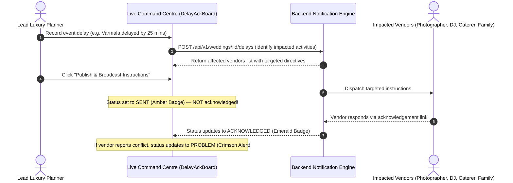

#  The Royal Knot — Wedding Operations & Intelligence Platform
### *Standalone Enterprise Operations & Financial Management System for Luxury Wedding Agencies*

[](frontend/)
[](frontend/src/index.css)
[](https://recharts.org/)
[](backend/)
[](backend/prisma/)
[](https://supabase.com/)

> *"One connected platform. Every wedding. Every vendor. Every payment. Every decision."*

---

## 1. System Overview

**The Royal Knot** is an independent, standalone enterprise operations and financial management platform designed for premier luxury destination wedding planning agencies in **Jaipur and Udaipur**.

Planning ~25 luxury three-day destination weddings annually—each hosting **400+ guests**, managing **~18 vendor categories**, and handling multi-crore budgets—demands unified operational tracking and strict financial controls.

The platform eliminates fragmented communication across WhatsApp chats, unstandardized PDFs, and paper notebooks by managing the complete wedding lifecycle within **One Central Wedding Record**:

$$\text{Client Enquiry} \longrightarrow \text{Digital Agreement} \longrightarrow \text{Vendor Procurement} \longrightarrow \text{Instant 25+ Plan} \longrightarrow \text{Command Centre} \longrightarrow \text{Closed-Loop Delay Ack} \longrightarrow \text{Reconciliation} \longrightarrow \text{Season Profit}$$

> [!NOTE]
> **Strict Standalone Architecture**: This project is built 100% from scratch using standard web technologies. It does not use Odoo, its framework, ORM, modules, or proprietary code.

---

## 2. Technology Stack

| Layer | Technology | Key Libraries & Purpose |
| :--- | :--- | :--- |
| **Frontend** | **React 19 + Vite 8** | TypeScript, Tailwind CSS v4, Lucide React (Icons), Recharts (Financial analytics) |
| **Backend** | **Node.js 22 + Express** | TypeScript, Express.js REST API, Zod validations, Idempotency engine |
| **Database & ORM** | **PostgreSQL + Prisma** | Relational schema, transactional integrity, automated migrations |
| **Authentication** | **Supabase Auth** | Invited user identity, JWT bearer token verification, role scoping |
| **Storage** | **Supabase Private Storage** | Signed service agreements, venue floorplans, vendor invoices |
| **Deployment** | **Vercel** | Serverless backend deployment, static frontend edge hosting |

---

## 3. Monorepo Structure

```text
ODOO_Finals/
├── frontend/                         # Frontend Application (React, Vite, Tailwind CSS)
│   ├── src/
│   │   ├── components/
│   │   │   ├── common/               # Reusable UI system (Button, Input, Select, Modal, DataTable, etc.)
│   │   │   ├── domain/               # Core business components (QuoteMatrix, RunSheet, DelayAckBoard, etc.)
│   │   │   └── layout/               # Responsive shell (AppLayout, Sidebar, TopHeader)
│   │   ├── pages/                    # 11 Dedicated application views
│   │   ├── services/                 # Typed API client & state persistence
│   │   ├── types/                    # Shared TypeScript domain models
│   │   ├── App.tsx & main.tsx        # Application root and state router
│   │   └── index.css                 # Tailwind v4 theme & luxury tokens
│   ├── package.json
│   ├── tsconfig.json
│   └── vite.config.ts
│
├── backend/                          # Backend Services (Node.js, Express, Prisma)
│   ├── prisma/
│   │   ├── migrations/               # Transactional SQL schema migrations
│   │   └── schema.prisma             # PostgreSQL data model
│   ├── src/
│   │   ├── access.ts                 # Scoped authorization & role checks
│   │   ├── application.ts            # Core Express routes & business logic
│   │   ├── contracts.ts              # Shared request/response TypeScript interfaces
│   │   ├── identity.ts               # Supabase token validation & user resolution
│   │   └── server.ts                 # HTTP server entrypoint
│   ├── tests/                        # Isolated integration test suites
│   ├── openapi.json                  # Generated OpenAPI 3.1 specification
│   ├── package.json
│   └── tsconfig.json
│
├── README.md
├── FRONTEND_ARCHITECTURE_PLAN.md
└── LICENSE
```

---

## 4. Key Differentiator: Closed-Loop Wedding-Day Coordination

The platform's standout differentiator is its **Closed-Loop Schedule Change Engine**:



**Strict Rule Enforced**: A sent notification **never automatically counts as acknowledged**. The planner maintains real-time visibility into who has confirmed and who is still pending.

---

## 5. Frontend Architecture & UI System

### 5.1 Luxury Heritage Aesthetic
Styled specifically for destination weddings at Udaipur's Lake Palaces and Jaipur's Royal Forts:
* **Palace Navy (`#0D1B2A` / `#1B3B6F`)**: Primary structural surfaces, headers, and action anchors.
* **Jaipur Heritage Gold (`#C5A059` / `#DFCA9B`)**: VIP tags, winner highlights, and gold foil accents.
* **Palace Ivory (`#FDFBF7`)**: Warm off-white canvas preventing clinical admin fatigue.
* **Status Alerts**: High-contrast semantic signals (Emerald Green, Crimson Alert, Amber Waiting).

### 5.2 Reusable Component Library (`frontend/src/components/common/`)
* **`Button.tsx`**: Multi-variant button system (`primary`, `gold`, `secondary`, `danger`, `ghost`) with integrated `Loader2` spinner states and icon slots.
* **`FormField.tsx`**, **`Input.tsx`**, **`Select.tsx`**: Luxury inputs featuring Jaipur Gold focus rings (`ring-[#C5A059]`) and validation helper text.
* **`DataTable.tsx`**: Generic typed `<T>` table supporting client-side column sorting, pagination (10/25/50), custom cell renderers, and empty state handling.
* **`SearchFilterBar.tsx`**: Real-time multi-facet search bar with instant clear button and category filter pills.
* **`Modal.tsx` & `ConfirmDialog.tsx`**: Accessible dialogs with backdrop blur and keyboard `ESC` dismissal.
* **`StatCard.tsx` & `StatusBadge.tsx`**: High-density KPI cards with trend indicators and semantic status pills.

### 5.3 The 11 Core Navigation Pages
1. **Overview (`/`)**: Executive Founder Dashboard with 25-wedding season metrics, Recharts financial margin bar charts, and day-of operational radar.
2. **Enquiries (`/enquiries`)**: 400+ guest enquiry capture with **Digital Agreement Gating** (locks vendor databases until agreement is signed) and "New Enquiry" modal.
3. **Clients (`/clients`)**: Client directory with sortable `DataTable<Wedding>`, verified POCs, and signed contracts.
4. **Weddings (`/weddings`)**: Central Wedding Workspace with Full-Service vs. Partial/Day-Of package switcher and sub-events (Mehendi, Sangeet, Varmala, Reception).
5. **Vendors (`/vendors`)**: Sortable vendor directory across 18 categories with verified punctuality metrics and star reliability ratings.
6. **Quotations (`/quotations`)**: **3-Caterer Side-by-Side Comparison Matrix** evaluating price/plate, extra-hour rates, and menu inclusions with 1-click winner selection that auto-rejects losing bids.
7. **Planning Tasks (`/tasks`)**: **25+ Pre-seeded tasks** across a 4-stage Kanban (*To Plan*, *In Progress*, *Review*, *Done*) with owner assignments and function tags.
8. **Command Centre (`/command-centre`)**: Minute-by-minute run sheet, vendor arrival check-in with **Red Late Alerts**, **Closed-Loop Delay Coordination Board**, and live incident tickets.
9. **Finance (`/finance`)**: Change order manager (+60 unexpected guests, +1 DJ hr), 3-stage client milestones, and **Vendor Settlement with Anti-Duplicate Payment Shield**.
10. **Reports (`/reports`)**: Official season P&L statement and wedding-by-wedding margin breakdown.
11. **Settings (`/settings`)**: Agency profile (Jaipur & Udaipur) and role-based permissions (Planner, Coordinator, Finance, Founder).

---

## 6. Backend Architecture & Integration (Codex)

### 6.1 Core API Capabilities
* **Identity & Access**: Verified Supabase JWT identities, active account checks, and role enforcement (Founder, Planner, Coordinator, Finance, Client).
* **Separate Central Wedding UUID**: Atomically generated on enquiry creation (`Wedding.id` $\ne$ `Enquiry.id`). All future records reference this stable UUID.
* **Idempotency Engine**: Mandatory `Idempotency-Key` header on all mutating requests (`POST`, `PATCH`, `DELETE`) preventing accidental duplicate submissions.
* **Consultation Overlap Shield**: Database-enforced scheduling validation preventing overlapping planner appointments with 409 `SCHEDULING_CONFLICT`.
* **Prisma Schema & Migrations**: Private business schema with transactional integrity and backend-only RLS policies.

### 6.2 Key Backend Contracts & Guides
* **[Phase 1 Integration Guide](backend/INTEGRATION.md)**: Frontend handoff documentation, role matrix, and endpoint specification.
* **[OpenAPI Specification](backend/openapi.json)**: Complete OpenAPI 3.1 schema (served at `/api/v1/openapi.json`).
* **[Shared TypeScript Contracts](backend/src/contracts.ts)**: Authoritative request and response models.
* **[Deployment Guide](backend/DEPLOYMENT.md)**: Supabase and Vercel configuration instructions.
* **[Phase 1 Verification Report](backend/PHASE_1_REPORT.md)**: Backend test suite and integration audit.

---

## 7. Local Setup & Quickstart

### Prerequisites
* **Node.js**: `v22.x` or `v24.x`
* **npm**: `v10.x` or `v11.x`

### 7.1 Running the Frontend
```bash
cd frontend
npm install
npm run dev
```
Open [http://localhost:5173](http://localhost:5173) in your browser.

To verify the production build:
```bash
cd frontend
npm run build
```

### 7.2 Running the Backend
```bash
cd backend
npm ci
cp .env.example .env
# Populate server credentials in .env (on Windows PowerShell: Copy-Item .env.example .env)

npm run db:migrate
npm run db:provision
npm run bootstrap:founder
npm run dev
```

To run the backend test suite:
```bash
cd backend
npm test
```
*Note: `npm test` runs against an isolated local PostgreSQL test instance and verifies migrations, OpenAPI drift, and API authorization.*

---

## 8. Development Phases & Roadmap

| Phase | Description | Status |
| :---: | :--- | :---: |
| **Phase 0A** | Standalone Frontend Architecture, Design System Tokens, Mock Service | ✅ **Completed** |
| **Phase 1** | Node.js/Express Backend, Prisma Schema, Supabase Auth, Enquiries & Weddings APIs | ✅ **Completed** |
| **Phase 1A** | UI Foundation, Reusable Component Library, AppLayout, 11 Working Pages | ✅ **Completed** |
| **Phase 2A** | Client Dossiers, Enquiry Intake, Consultations, Agreement Gating & Vendor Directory | ✅ **Completed** |
| **Phase 2B** | Digital Agreements, Vendor Procurement & 3-Caterer RFQ Comparison | ⏳ **In Progress** |
| **Phase 3A** | Dedicated Wedding Workspace, Sub-Functions & Multi-View Task Management | ✅ **Completed** |
| **Phase 3B** | Backend Automated 25+ Task Generation & Template Seeding Engine | ⏳ Upcoming |
| **Phase 4A** | Live Command Centre, Vendor Arrival Board, Closed-Loop Delay Engine & Incidents | ✅ **Completed** |
| **Phase 4B** | Real-time WebSocket Notifications & Dispatch Automation | ⏳ Upcoming |
| **Phase 5A** | Client & Vendor Payments, Change Orders (+60 Guests), 5-Way Reconciliation & Founder Dashboard | ✅ **Completed** |
| **Phase 5B** | Backend Automated Payment Webhooks & Ledger Synchronization | ⏳ Upcoming |
| **Phase 6A** | Complete Frontend Integration, 11-Screen Interaction QA & Demo Readiness | ✅ **Completed** |
| **Phase 6B** | Advanced Multi-Season Forecasting & Cross-Year Benchmarking | ⏳ Upcoming |

---

## 9. Team & Collaboration Rules

* **Branch Discipline**: Work exclusively on branch `main`. No feature branches, no pull requests, no force-pushes.
* **Pull Before Starting**: Always run `git pull --rebase origin main` before starting a task.
* **Architecture Separation**: Frontend code lives in `frontend/`; backend services live in `backend/`.
* **Zero Fake UI**: All frontend elements have real state handlers; no nonfunctional buttons.
* **Financial Authority**: Financial values and reconciliation calculations are authoritative on the backend.

---

## 10. End-to-End Executive Demo Walkthrough

The Royal Knot platform is primed for stakeholder demonstration following this 6-stage operational narrative:

1. **Intake & Agreement Gating (`/enquiries`)**:
   - Inspect the 400+ guest enquiry for Rahul Sharma & Ananya Singh at Jagmandir Palace.
   - Click "Review & Attach Signed Agreement" and verify the manual review note to unlock gated vendor quotation records.
2. **Procurement & 3-Caterer RFQ Matrix (`/quotations`)**:
   - Compare SpiceHeaven Royal Caterers against competing bidders across price/plate, extra-hour rates, and menu inclusions.
   - Click "Select Caterer" to award the contract, which automatically marks losing bidders as rejected.
3. **Workspace & Task Automation (`/tasks`)**:
   - Review 35 automated planning tasks seeded for the Full-Service package across Mehendi, Sangeet, Pheras, and Reception.
   - Filter by function or owner, drag/click stage to *In Progress* or *Done*, and inspect milestone deadlines.
4. **Day-of Command Centre (`/command-centre`)**:
   - Monitor the minute-by-minute run sheet with live IST time tracking.
   - Check in late vendors on the Vendor Arrival Board with real-time delay tags.
   - Execute the **Closed-Loop Schedule Change Engine**: Propose a 25-minute delay on Varmala, observe cascade instructions to affected vendors, publish the change, and verify that notifications marked `SENT` remain unconfirmed until explicit vendor acknowledgement.
5. **Change Orders, Reconciliation & Anti-Duplicate Shield (`/finance`)**:
   - Create and approve change orders for 60 unexpected banquet guests (₹1,50,000) and an extended DJ hour (₹15,000).
   - Inspect the 5-way reconciliation comparison: Net Due = (Quotation + Extras) - Advances Paid.
   - Disburse the final balance and observe the **Anti-Duplicate Payment Shield** preventing double payments.
6. **Founder Executive Dashboard (`/reports`)**:
   - Review the official Season P&L statement, wedding-by-wedding profitability ledger, and interactive Recharts visualizations.
