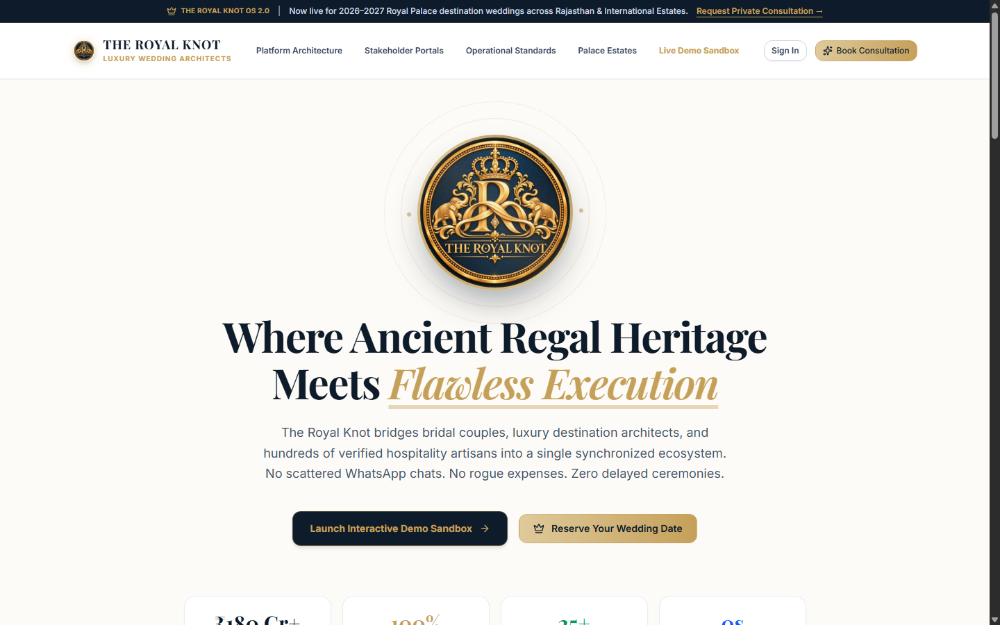
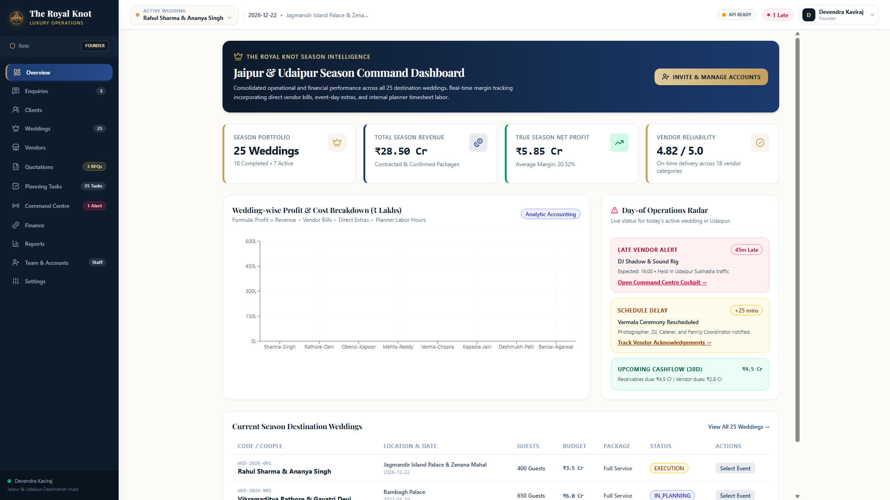
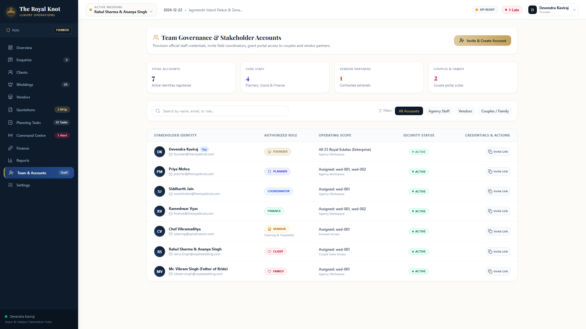
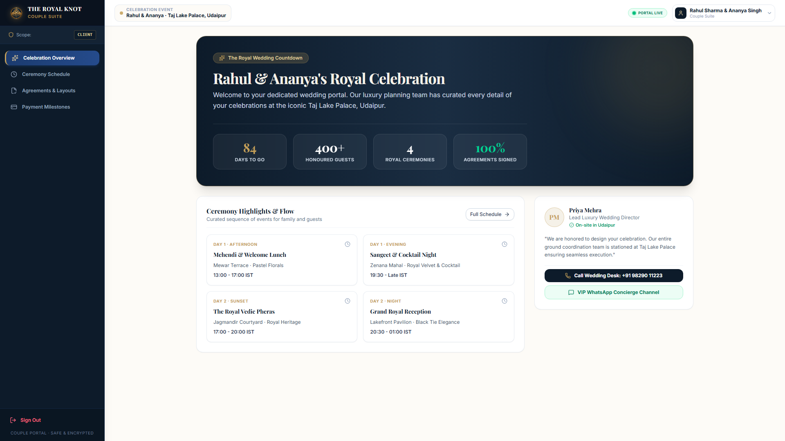
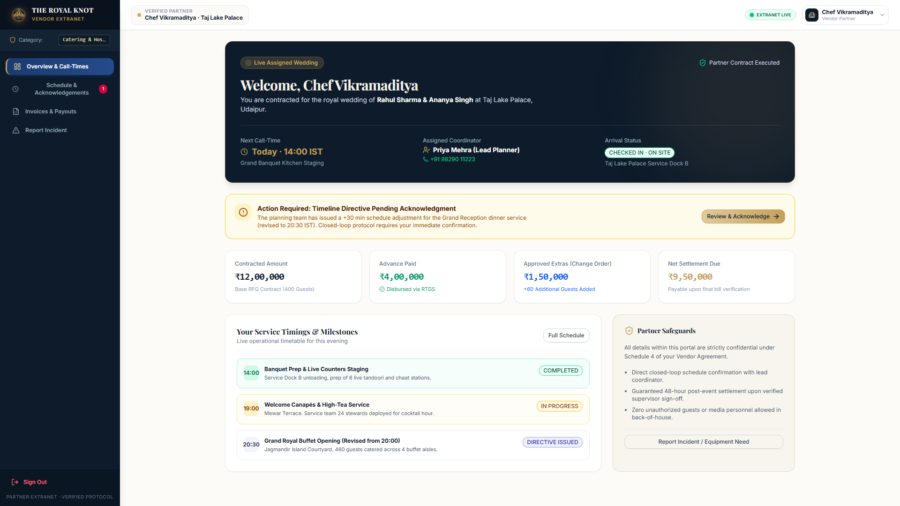
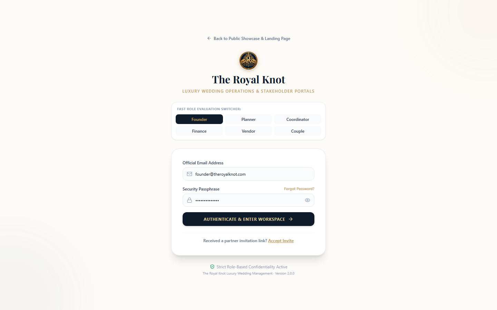
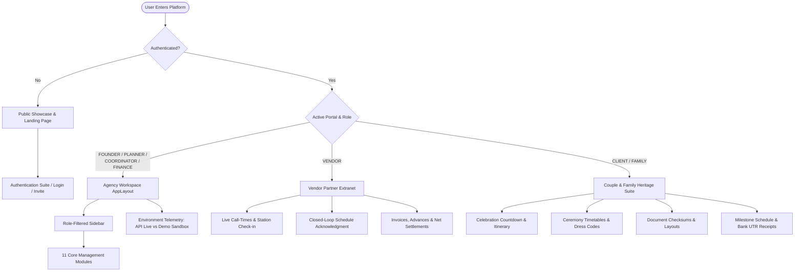
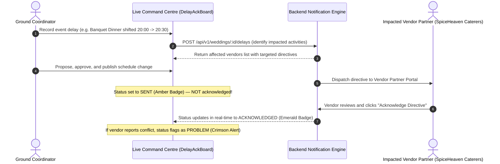

# The Royal Knot — Wedding Operations & Intelligence Platform
### *Standalone Enterprise Operations, Financial Management & Multi-Stakeholder Portal System for Luxury Wedding Agencies*

[](frontend/)
[](frontend/src/index.css)
[](https://recharts.org/)
[](backend/)
[](backend/prisma/)
[](https://supabase.com/)
[](https://www.npmjs.com/package/libphonenumber-js)
[-success)](backend/tests/)

> *"One connected ecosystem. Every royal palace. Every vendor partner. Every payment milestone. Every live decision."*

---

## 1. System Overview

**The Royal Knot** is an independent, standalone enterprise operations and financial management platform purpose-built for premier luxury destination wedding planning agencies managing high-profile celebrations in **Jaipur, Udaipur, Jodhpur, and international palace estates**.

Planning ~25 ultra-luxury destination weddings annually—each hosting **400+ guests**, managing **~18 specialized vendor categories**, and handling multi-crore budgets—demands unified operational tracking, airtight financial controls, and dedicated multi-stakeholder interfaces.

The platform eliminates fragmented communication across WhatsApp chats, unstandardized PDFs, and paper notebooks by unifying the complete wedding lifecycle within **One Central Wedding Record**:

$$\text{Public Showcase} \longrightarrow \text{Enquiry Intake} \longrightarrow \text{Document Integrity} \longrightarrow \text{Vendor Procurement} \longrightarrow \text{Automated 25+ Plan} \longrightarrow \text{Live Command Centre} \longrightarrow \text{Closed-Loop Delay Ack} \longrightarrow \text{5-Way Reconciliation} \longrightarrow \text{Season Profitability}$$

> [!NOTE]
> **Strict Standalone Architecture**: This software is engineered 100% from scratch using standard modern web technologies. It contains zero Odoo modules, zero Odoo dependencies, and zero proprietary framework abstractions.

---

## 2. Visual Platform Tour

### 2.1 Cinematic Public Showcase & Interactive 3D Imperial Seal
The public landing experience combines luxury editorial typography, smooth progressive entrance animations, and an interactive 3D WebGL2 royal crest medallion rendered in Three.js with golden specular lighting and cursor parallax:



### 2.2 Founder Season Command Dashboard
Consolidated operational and financial analytics across all 25 active and completed palace weddings in Jaipur & Udaipur with real-time margin tracking and day-of operations radar:



### 2.3 Team Governance, Server-Side Pagination & Account Provisioning
Exclusive to the Founder role: provision official credentials, invite field coordinators, grant portal access to couples and vendor partners, and inspect paged team accounts with live backend `LIMIT`/`OFFSET` queries:



### 2.4 Couple & Client Heritage Suite
Dedicated couple portal providing royal ceremony countdown, day-by-day event flow, verified service documents, and payment milestone tracking:



### 2.5 Vendor Partner Extranet
Dedicated extranet with closed-loop delay acknowledgments, real-time call-times, station check-in status, and invoice disbursements via scoped 24-hour capability tokens:



### 2.6 Security-Hardened Authentication & Quick Persona Switcher
Strict role-based gating, exact case-sensitive passphrase validation, client-side rate-limiting and brute-force protection, official email verification, and rapid evaluation switcher:



---

## 3. Technology Stack

| Layer | Technology | Key Libraries & Purpose |
| :--- | :--- | :--- |
| **Frontend** | **React 19 + Vite 8** | TypeScript, Tailwind CSS v4, Lucide React (Icons), Recharts (Financial analytics), Context API |
| **Backend** | **Node.js 22 + Express** | TypeScript, Express.js REST API, Zod runtime validation, Idempotency engine |
| **Data Validation** | **libphonenumber-js** | Canonical international standard parsing & E.164 normalization for Indian & global numbers |
| **Database & ORM** | **PostgreSQL + Prisma** | Relational schema, transactional integrity, 10 automated SQL migrations, Row Level Security (RLS) |
| **Authentication** | **Supabase Auth / Custom RBAC** | Identity provider, JWT bearer token verification, role scoping, rate-limiting |
| **Storage & Hashing** | **Web Crypto API (SHA-256)** | Cryptographic document integrity checksums, tamper-evident document attachments |
| **Testing** | **Node.js Test Runner + tsx** | **125 automated tests across 20 suites** running against isolated embedded PostgreSQL |

---

## 4. Monorepo Structure

```text
ODOO_Finals/
├── frontend/                         # Frontend Application (React 19, Vite 8, Tailwind CSS v4)
│   ├── src/
│   │   ├── components/
│   │   │   ├── client/               # Dedicated Couple & Family Suite Layout
│   │   │   ├── common/               # Reusable UI system (DataTable, Button, ThemeToggle, Modal, etc.)
│   │   │   ├── domain/               # Domain components (QuoteMatrix, RunSheet, DelayAckBoard, etc.)
│   │   │   ├── layout/               # Agency shell (AppLayout, Sidebar, TopHeader with telemetry badge)
│   │   │   └── vendor/               # Dedicated Vendor Partner Portal Layout
│   │   ├── context/
│   │   │   ├── AuthContext.tsx       # Hardened case-sensitive auth, portal router & demo sandbox gating
│   │   │   ├── ThemeContext.tsx      # Dark Palace / Light Ivory theme state engine
│   │   │   └── WeddingContext.tsx    # Single source of truth for active event & enquiry selection
│   │   ├── pages/
│   │   │   ├── auth/                 # Complete Auth Suite (Login, Invite, Reset, Deactivated, 403)
│   │   │   ├── client/               # Couple & Family Portal (Overview, Schedule, Documents, Payments)
│   │   │   ├── vendor/               # Vendor Partner Portal (Overview, Schedule Ack, Invoices)
│   │   │   ├── LandingPage.tsx       # Luxury Public Showcase & Interactive Demo Sandbox
│   │   │   └── [Agency Pages]        # 11 Dedicated enterprise workspace views
│   │   ├── services/
│   │   │   ├── api.ts                # Typed API client, server pagination, document hashing & demo guard
│   │   │   └── mockData.ts           # Clean seed data for demo evaluation
│   │   ├── utils/
│   │   │   └── phone.ts              # Client-side phone parsing, E.164 formatting & validation
│   │   ├── types/                    # Domain models & TypeScript interfaces
│   │   ├── App.tsx & main.tsx        # Multi-stakeholder state router & context providers
│   │   └── index.css                 # Tailwind v4 theme, Palace Dark palette & luxury tokens
│   ├── package.json
│   ├── tsconfig.json
│   └── vite.config.ts
│
├── backend/                          # Backend Services (Node.js 22, Express, Prisma, PostgreSQL)
│   ├── prisma/
│   │   ├── migrations/               # 10 Transactional SQL schema migrations
│   │   └── schema.prisma             # PostgreSQL relational data model with RLS
│   ├── src/
│   │   ├── access.ts                 # Role-based authorization & tenant isolation guards
│   │   ├── application.ts            # Core Express routes, security middleware & error handling
│   │   ├── config.ts                 # Environment validation (DATABASE_URL, SUPABASE_*, PORT)
│   │   ├── contracts.ts              # Zod request/response interfaces, pagination limits, phoneSchema
│   │   ├── database.ts               # PostgreSQL connection pool & Prisma client instance
│   │   ├── errors.ts                 # Centralized HTTP API error hierarchy
│   │   ├── finance-contracts.ts      # Financial ledgers, invoices & reconciliation schemas
│   │   ├── identity.ts               # Supabase identity provider adapter & session verification
│   │   ├── operations-contracts.ts   # Run sheets, vendor arrivals & incident schemas
│   │   ├── storage.ts                # S3/Supabase storage adapter for signed document attachments
│   │   ├── task-templates.ts         # Automated planning checklists (Full Service & Day-Of)
│   │   ├── workflow-contracts.ts     # Vendors, quotations, enquiries & libphonenumber-js contracts
│   │   ├── controllers/              # HTTP request handlers (auth, clients, weddings)
│   │   ├── http/routes.ts            # Central route registrar & OpenAPI route registry
│   │   ├── middleware/               # JWT authentication & session verification middleware
│   │   ├── routes/                   # 15 Express REST API route modules
│   │   ├── services/                 # 10 Domain services (finance, operations, planning, quotations, etc.)
│   │   └── server.ts                 # HTTP server entrypoint
│   ├── docs/
│   │   └── archive/phase-reports/    # 15 Historical phase specifications, reports & audits
│   ├── scripts/
│   │   ├── bootstrap-founder.ts      # Seeds initial Founder account into DB and auth provider
│   │   ├── openapi.ts                # Generates openapi.json and verifies zero schema drift
│   │   ├── provision.ts              # Provisions database roles, RLS policies & connection grants
│   │   └── test.ts                   # Embedded PostgreSQL cluster harness & test runner
│   ├── tests/                        # 13 Automated test suites (125 tests passing)
│   │   ├── auth-security.test.ts
│   │   ├── e2e.test.ts
│   │   ├── finance.test.ts
│   │   ├── foundation.test.ts
│   │   ├── identity.test.ts
│   │   ├── integration.test.ts
│   │   ├── migration-upgrade.test.ts
│   │   ├── operations.test.ts
│   │   ├── phone-validation.test.ts  # 15 Automated phone validation & normalization tests
│   │   ├── qa.test.ts
│   │   ├── security-authorization.test.ts # 8 Database-backed RBAC boundary tests
│   │   ├── security.test.ts
│   │   └── workflows.test.ts
│   ├── DEPLOYMENT.md                 # Deployment & environment setup guide
│   ├── INTEGRATION.md                # Canonical API integration specifications & auth contracts
│   ├── SCHEMA_AUDIT_REPORT.md        # PostgreSQL database inventory, foreign keys & RLS audit
│   ├── SECURITY_AUTH_AUDIT.md        # Role authorization matrix & permission controls
│   ├── openapi.json                  # Complete OpenAPI 3.1 schema specification
│   ├── package.json
│   └── tsconfig.json
│
├── README.md
└── LICENSE
```

---

## 5. Multi-Stakeholder Role Architecture

The Royal Knot provides tailored, role-specific portal experiences while strictly enforcing data segregation and privacy guardrails.



### Role Segregation & Privacy Matrix

| Stakeholder Persona | Permitted Views | Strict Backend Privacy Safeguards |
| :--- | :--- | :--- |
| **Founder / Admin** | All 11 agency modules, season P&L, user governance, staff directory | Full administrative and self-escalation authority |
| **Lead Planner** | Overview, Enquiries, Clients, Weddings, Vendors, Quotations, Tasks, Command Centre, Reports | Blocked from viewing internal disbursements, vendor bills, or promoting self to Founder |
| **Ground Coordinator** | Assigned Weddings, Minute-by-Minute Run Sheet, Vendor Arrival Board, Incidents, Tasks | Gated from agency profits, financial ledgers, and vendor bidding comparisons |
| **Finance Manager** | Overview, Client Payment Milestones, Vendor Final Bills, Change Orders, 5-Way Reconciliation, Reports | Operational task editing and direct client intake assignment restricted |
| **Vendor Partner** | Scoped 24-hour capability token access: call-times, delay directives, invoice submission, bank disbursements | **Zero global user account**. Interacts via capability tokens. Zero visibility into competing bids or other events |
| **The Royal Couple** | Ceremony itinerary, dress codes, verified service documents, floor plans, payment receipts | **Zero visibility** into internal planner notes, vendor negotiations, staff rosters, or agency margins |
| **Family Member** | Ceremony schedules, venue logistics, hospitality updates | Client-tier persona: **Billing statements, payment receipts, and contract execution strictly hidden** |

---

## 6. Standout Operational & Architectural Differentiators

### 6.1 Server-Side Pagination & Currency-Aware Sorting
* **Server-Side Pagination:** [TeamAccountsPage.tsx](file:///c:/Users/pavan/OneDrive/Pictures/Desktop/ODOO_Finals/frontend/src/pages/TeamAccountsPage.tsx) queries `GET /api/v1/users?page=${page}&pageSize=${pageSize}` with true server-side slicing, server total count, interactive loading spinner, and retry error handling.
* **Non-Omitting Pagination Range:** Algorithm handles 1, 7, 8, 10, 20, and 100+ pages without omitting valid neighbor page numbers.
* **Numeric-Aware Financial Sorting:** The table sorting engine extracts real numeric values from Indian currency strings (e.g. `₹2.5 Cr` $\rightarrow 25,000,000$, `₹15 L` $\rightarrow 1,500,000$, `₹50,000` $\rightarrow 50,000$) rather than sorting them alphabetically.
* **Standardized Limits:** Options standardized to 10, 25, 50, and 100 rows per page (defaulting to 25), compatible with the backend's `max(100)` limit. Controls are positioned above the table for immediate accessibility.

### 6.2 Canonical Phone Validation & Normalization Engine
* Powered by `libphonenumber-js` across both frontend ([phone.ts](file:///c:/Users/pavan/OneDrive/Pictures/Desktop/ODOO_Finals/frontend/src/utils/phone.ts)) and backend contracts ([workflow-contracts.ts](file:///c:/Users/pavan/OneDrive/Pictures/Desktop/ODOO_Finals/backend/src/workflow-contracts.ts)).
* **Accepts & Normalizes:** 10-digit Indian numbers (`9829012345`), numbers with leading zeros (`09829012345`), prefixed `+91` (`+91 98290 12345`), and international numbers (`+1 415 555 2671`, `+44 20 7946 0991`) into standard E.164 (`+919829012345`).
* **Rejects:** Alphabetic text (`abc`), alphanumeric strings (`hello123`, `123abc`), too-short inputs (`12345`), too-long inputs, and fake country codes (`+999`).
* **Verified:** 15 automated test cases in [phone-validation.test.ts](file:///c:/Users/pavan/OneDrive/Pictures/Desktop/ODOO_Finals/backend/tests/phone-validation.test.ts).

### 6.3 Closed-Loop Schedule Change Engine
During live celebrations, timeline shifts (e.g. Baraat arriving 30 minutes late) are broadcast via the Command Centre:



> **Strict Rule**: A dispatched notification **never automatically counts as acknowledged**. The live command centre maintains complete visibility into who is ready and who has reported a conflict.

### 6.4 5-Way Financial Reconciliation & Anti-Duplicate Shield
Guarantees transparent accounting across multi-crore budgets:
1. **Original Agreed RFQ PO** (e.g. ₹12,00,000 for 400 guests).
2. **Approved Change Orders** (e.g. +60 additional banquet guests at ₹2,500/plate = ₹1,50,000).
3. **Advances Paid** via verified RTGS/NEFT banking references (e.g. ₹4,00,000).
4. **Final Claimed Invoice** submitted by the vendor partner.
5. **Net Balance Settlement**: $\text{Net Due} = (\text{Quotation} + \text{Approved Extras}) - \text{Advances Paid} = ₹9,50,000$.
* **Anti-Duplicate Shield**: The system enforces transactional checks that prevent identical invoice references or double disbursements against the same milestone.

### 6.5 Document Content Integrity vs Digital Signatures
* **Content Integrity Checksums:** Computes client-side SHA-256 hashes using the Web Crypto API to detect file tampering and ensure contract PDF integrity.
* **Manual Agency Review Workflow:** Distinct separation between file upload, checksum recording, and manual approval by the Founder or Lead Director.
* **Zero Fabricated Claims:** Completely free of fake Aadhaar verifications, invented signature IP addresses, or misleading legal claim labels.

### 6.6 Production vs Demo Sandbox Isolation
* In production deployments, login and data queries communicate strictly with the backend REST API. If the server is unreachable, the system fails explicitly with a retry prompt—**never silently falling back to LocalStorage**.
* Demo mode requires explicit opt-in (`VITE_ENABLE_DEMO_MODE=true` or `?demo=true`).
* Case-sensitive passphrases (`royalKnot2026!`) with zero case-insensitive leakage.

---

## 7. Frontend UI Architecture & Design System

### 7.1 Palace Luxury Aesthetic & Dark Mode Engine
* **Palace Navy (`#0D1B2A` / `#0A111C`)**: Structural surfaces, royal headers, and navigation anchors.
* **Jaipur Heritage Gold (`#C5A059` / `#DFCA9B`)**: Crest accents, VIP highlights, and interactive buttons.
* **Palace Ivory & Parchment (`#FDFBF7` / `#F5F1E8`)**: Warm light canvas eliminating clinical admin fatigue.
* **Dark Palace Theme Engine:** Comprehensive multi-page dark mode preserving high contrast on gold surfaces, dark navigation bars, and accessible secondary text.
* **Accessible Theme Switcher:** High-contrast toggle with proper `aria-pressed` semantics and `@keyframes spin-slow` animation.

### 7.2 Public Showcase & Interactive Demo Sandbox
Accessible directly at the root URL when unauthenticated:
* **Live Operational Telemetry**: Dynamic counters for budget managed (₹180 Cr+), palaces live (25+), and closed-loop compliance (100%).
* **1-Click Stakeholder Sandbox**: Test personas pre-configured for instant one-click login into any portal without password friction.
* **Heritage Palaces Showcase**: Taj Lake Palace (Udaipur), Rambagh Palace (Jaipur), and Umaid Bhawan Palace (Jodhpur).
* **Royal Intake Feasibility Form**: Real intake form recording into the pipeline with phone validation and returning verified booking reference codes.

---

## 8. Local Setup & Quickstart

### Prerequisites
* **Node.js**: `v22.x` or `v24.x`
* **npm**: `v10.x` or `v11.x`

### 8.1 Running the Frontend
```bash
cd frontend
npm install
npm run dev
```
Open [http://localhost:5173](http://localhost:5173) in your browser.

To verify the production build:
```bash
cd frontend
npm run build
```

To run the linter:
```bash
cd frontend
npm run lint
```

### 8.2 Running the Backend
```bash
cd backend
npm install
cp .env.example .env
# Populate server credentials in .env (on Windows PowerShell: Copy-Item .env.example .env)

npm run db:migrate
npm run db:provision
npm run bootstrap:founder
npm run dev
```

To verify OpenAPI contract sync:
```bash
cd backend
npm run contracts
```

To run the full backend test suite:
```bash
cd backend
npm test
```
*Note: `npm test` runs 125 automated tests across 20 suites against an isolated ephemeral PostgreSQL instance, testing schema migrations, OpenAPI compliance, RBAC authorization, and all business workflows.*

---

## 9. Development Phases & Roadmap

| Phase | Description | Status |
| :--- : | :--- | :---: |
| **Phase 0A** | Standalone Frontend Architecture, Design System Tokens, Mock Service | ✅ **Completed** |
| **Phase 1** | Node.js/Express Backend, Prisma Schema, Supabase Auth, Enquiries & Weddings APIs | ✅ **Completed** |
| **Phase 1A** | UI Foundation, Reusable Component Library, AppLayout, 11 Working Pages | ✅ **Completed** |
| **Phase 2A** | Client Dossiers, Enquiry Intake, Consultations, Agreement Gating & Vendor Directory | ✅ **Completed** |
| **Phase 2B** | Digital Agreements, Vendor Procurement & 3-Caterer RFQ Comparison | ✅ **Completed** |
| **Phase 3A** | Dedicated Wedding Workspace, Sub-Functions & Multi-View Task Management | ✅ **Completed** |
| **Phase 3B** | Backend Verified Deposits & Automated 25+ Task Generation Engine | ✅ **Completed** |
| **Phase 4A** | Live Command Centre, Vendor Arrival Board, Closed-Loop Delay Engine & Incidents | ✅ **Completed** |
| **Phase 4B** | Backend Command Centre: Versioned Schedule Changes, Approval & In-App Acknowledgements | ✅ **Completed** |
| **Phase 5A** | Client & Vendor Payments, Change Orders (+60 Guests), 5-Way Reconciliation & Founder Dashboard | ✅ **Completed** |
| **Phase 5B** | Backend Financial Management, Reconciliation & Founder Reporting | ✅ **Completed** |
| **Phase 6A** | Complete Frontend Integration, 11-Screen Interaction QA & Demo Readiness | ✅ **Completed** |
| **Phase 6B** | End-to-End Regression Test Suite (85/85 Passing) & Financial Integrity Verification | ✅ **Completed** |
| **Phase 7A** | Complete Frontend Audit, Defect Resolution & Multi-Stakeholder Portals (Vendor, Client, Family) | ✅ **Completed** |
| **Phase 7B** | Luxury Public Landing Page Showcase & Interactive Stakeholder Role Sandbox | ✅ **Completed** |
| **Phase 8** | Comprehensive Pagination, Palace Dark Mode, Phone Validation & Security Hardening | ✅ **Completed** |
| **Phase 9** | Backend Directory Cleanup, Dead File Audit, Historical Archive & 125-Test Verification | ✅ **Completed** |

---

## 10. Team & Collaboration Rules

* **Branch Discipline**: Work exclusively on branch `main`. No feature branches, no pull requests, no force-pushes.
* **Pull Before Starting**: Always run `git pull --rebase origin main` before starting a task.
* **Architecture Separation**: Frontend code lives in `frontend/`; backend services live in `backend/`.
* **Zero Fake UI**: All frontend elements have real state handlers; no nonfunctional buttons or mock success alerts.
* **Financial Authority**: Financial values and reconciliation calculations are authoritative on the backend.
* **Documentation Integrity**: Keep root documentation clean and up to date; archive intermediate phase reports into `backend/docs/archive/phase-reports/`.

---

## 11. End-to-End Stakeholder Demo Walkthrough

The platform can be demonstrated through the following complete narrative:

1. **Public Showcase & Date Feasibility (`/`)**:
   - Explore the luxury landing page, review live operational telemetry, and open the "Book Consultation" modal to submit an enquiry with verified international phone formatting.
2. **Interactive Role Sandbox**:
   - Click the **Founder & CEO** card in the sandbox to immediately launch into the enterprise workspace.
3. **Team Accounts & Server Pagination (`/team`)**:
   - Inspect staff accounts with live server-side pagination, 10/25/50/100 row selectors, and role-based permissions.
4. **Intake & Service Documents (`/enquiries`)**:
   - Inspect the 400+ guest enquiry for Rahul Sharma & Ananya Singh.
   - Review uploaded contract PDF with SHA-256 tamper-evident checksum and manual agency founder approval.
5. **3-Caterer RFQ Matrix (`/quotations`)**:
   - Compare SpiceHeaven Royal Caterers against competing bidders across price/plate, extra-hour rates, and menu inclusions.
   - Award the contract to SpiceHeaven; verify losing bids are automatically marked rejected.
6. **Workspace & Task Automation (`/tasks`)**:
   - Review 35 automated planning tasks seeded for the Full-Service package across Mehendi, Sangeet, Pheras, and Reception.
   - Filter by ceremony function or owner, and transition tasks across Kanban stages.
7. **Day-of Live Command Centre (`/command-centre`)**:
   - Monitor the minute-by-minute run sheet with live IST time tracking.
   - Inspect the Vendor Arrival Board with real-time late alerts.
   - Propose a +30 min schedule change on the Grand Reception Dinner; publish the change and observe that notification status remains `SENT` until vendor acknowledgment.
8. **Switch to Vendor Partner Portal**:
   - Use the profile menu to switch to the **Vendor Partner Portal** (`Chef Vikramaditya, SpiceHeaven`).
   - View the revised dinner timing directive; submit an operational acknowledgment note or report a conflict.
   - Inspect contracted amounts (₹12,00,000), advances disbursed (₹4,00,000), approved extras (+60 guests: ₹1,50,000), and submit a final tax bill.
9. **Switch to Couple & Family Suite**:
   - Use the profile menu to switch to **The Royal Couple** (`Rahul & Ananya`).
   - View the 84-day countdown, ceremony dress codes, verified service documents, and milestone payment receipts with bank UTR numbers.
   - Switch to **Family Member Mode** (`Mr. Vikram Singh, Father of Bride`) to observe that billing records and contracts are strictly hidden while ceremony logistics remain accessible.
10. **5-Way Reconciliation & Anti-Duplicate Shield (`/finance`)**:
    - Return to the Agency Workspace under Finance.
    - Review change orders (+60 guests) and inspect the 5-way reconciliation balance.
    - Disburse the final balance and observe the **Anti-Duplicate Shield** protecting against duplicate payouts.
11. **Founder Executive Dashboard (`/reports`)**:
    - Review the official Season P&L statement, wedding-by-wedding profitability ledger, and interactive Recharts visualizations.
