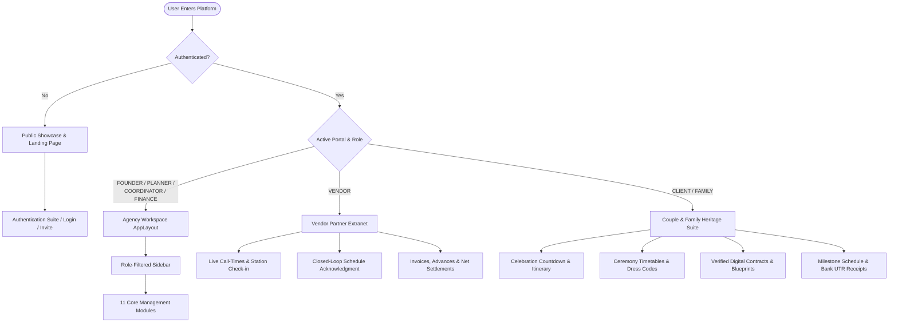
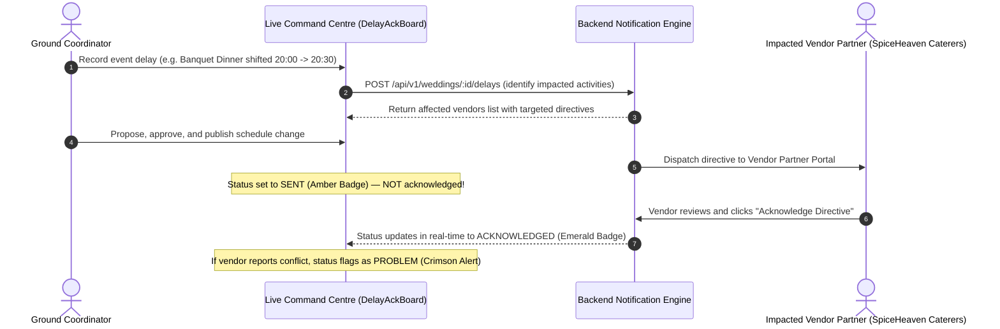

# The Royal Knot — Wedding Operations & Intelligence Platform
### *Standalone Enterprise Operations, Financial Management & Multi-Stakeholder Portal System for Luxury Wedding Agencies*

[](frontend/)
[](frontend/src/index.css)
[](https://recharts.org/)
[](backend/)
[](backend/prisma/)
[](https://supabase.com/)
[](backend/tests/)

> *"One connected ecosystem. Every royal palace. Every vendor partner. Every payment milestone. Every live decision."*

---

## 1. System Overview

**The Royal Knot** is an independent, standalone enterprise operations and financial management platform purpose-built for premier luxury destination wedding planning agencies managing high-profile celebrations in **Jaipur, Udaipur, Jodhpur, and international palace estates**.

Planning ~25 ultra-luxury destination weddings annually—each hosting **400+ guests**, managing **~18 specialized vendor categories**, and handling multi-crore budgets—demands unified operational tracking, airtight financial controls, and dedicated multi-stakeholder interfaces.

The platform eliminates fragmented communication across WhatsApp chats, unstandardized PDFs, and paper notebooks by unifying the complete wedding lifecycle within **One Central Wedding Record**:

$$\text{Public Showcase} \longrightarrow \text{Enquiry Intake} \longrightarrow \text{Digital Agreement} \longrightarrow \text{Vendor Procurement} \longrightarrow \text{Automated 25+ Plan} \longrightarrow \text{Live Command Centre} \longrightarrow \text{Closed-Loop Delay Ack} \longrightarrow \text{5-Way Reconciliation} \longrightarrow \text{Season Profitability}$$

> [!NOTE]
> **Strict Standalone Architecture**: This software is engineered 100% from scratch using standard web technologies. It contains zero Odoo modules, zero Odoo dependencies, and zero proprietary framework abstractions.

---

## 2. Technology Stack

| Layer | Technology | Key Libraries & Purpose |
| :--- | :--- | :--- |
| **Frontend** | **React 19 + Vite 8** | TypeScript, Tailwind CSS v4, Lucide React (Icons), Recharts (Financial analytics), Context API |
| **Backend** | **Node.js 22 + Express** | TypeScript, Express.js REST API, Zod validations, Idempotency engine |
| **Database & ORM** | **PostgreSQL + Prisma** | Relational schema, transactional integrity, automated SQL migrations |
| **Authentication** | **Supabase Auth** | Invited user identity, JWT bearer token verification, role scoping |
| **Storage** | **Supabase Private Storage** | Signed service agreements, venue floorplans, vendor invoices |
| **Testing** | **Node.js Test Runner + tsx** | 85 automated integration and end-to-end regression tests with embedded PostgreSQL |

---

## 3. Monorepo Structure

```text
ODOO_Finals/
├── frontend/                         # Frontend Application (React 19, Vite 8, Tailwind CSS v4)
│   ├── src/
│   │   ├── components/
│   │   │   ├── client/               # Dedicated Couple & Family Suite Layout
│   │   │   ├── common/               # Reusable UI system (Button, Input, Select, Modal, DataTable, etc.)
│   │   │   ├── domain/               # Domain components (QuoteMatrix, RunSheet, DelayAckBoard, etc.)
│   │   │   ├── layout/               # Agency shell (AppLayout, Sidebar, TopHeader with user menu)
│   │   │   └── vendor/               # Dedicated Vendor Partner Portal Layout
│   │   ├── context/
│   │   │   ├── AuthContext.tsx       # Multi-role authentication & portal router context
│   │   │   └── WeddingContext.tsx    # Single source of truth for active event & enquiry selection
│   │   ├── pages/
│   │   │   ├── auth/                 # Complete Auth Suite (Login, Invite, Reset, Deactivated, 403)
│   │   │   ├── client/               # Couple & Family Portal (Overview, Schedule, Documents, Payments)
│   │   │   ├── vendor/               # Vendor Partner Portal (Overview, Schedule Ack, Invoices)
│   │   │   ├── LandingPage.tsx       # Luxury Public Showcase & Interactive Demo Sandbox
│   │   │   └── [Agency Pages]        # 11 Dedicated enterprise workspace views
│   │   ├── services/                 # Typed API client, health monitoring & persistent demo storage
│   │   ├── types/                    # Domain models & TypeScript interfaces
│   │   ├── App.tsx & main.tsx        # Multi-stakeholder state router & context providers
│   │   └── index.css                 # Tailwind v4 theme & luxury tokens
│   ├── package.json
│   ├── tsconfig.json
│   └── vite.config.ts
│
├── backend/                          # Backend Services (Node.js 22, Express, Prisma, PostgreSQL)
│   ├── prisma/
│   │   ├── migrations/               # 9 Transactional SQL schema migrations
│   │   └── schema.prisma             # PostgreSQL relational data model
│   ├── src/
│   │   ├── access.ts                 # Role-based authorization & permission checks
│   │   ├── application.ts            # Core Express routes & business logic
│   │   ├── contracts.ts              # Authoritative request/response TypeScript interfaces
│   │   ├── identity.ts               # Supabase token validation & user resolution
│   │   ├── services/                 # Domain services (finance, operations, documents, planning)
│   │   └── server.ts                 # HTTP server entrypoint
│   ├── tests/                        # 85 Automated E2E & integration test suites
│   ├── openapi.json                  # Complete OpenAPI 3.1 schema specification
│   ├── package.json
│   └── tsconfig.json
│
├── README.md
└── LICENSE
```

---

## 4. Multi-Stakeholder Role Architecture

The Royal Knot provides tailored, role-specific portal experiences while strictly enforcing data segregation and privacy guardrails.



### Role Segregation & Privacy Matrix

| Stakeholder Persona | Permitted Views | Strict Privacy Safeguards |
| :--- | :--- | :--- |
| **Founder / Admin** | All 11 agency modules, season P&L, multi-season analytics, user governance | Full administrative access |
| **Lead Planner** | Overview, Enquiries, Clients, Weddings, Vendors, Quotations, Tasks, Command Centre, Reports | Finance disbursements gated |
| **Ground Coordinator** | Assigned Weddings, Minute-by-Minute Run Sheet, Vendor Arrival Board, Incidents, Tasks | Gated from agency profits & quotations |
| **Finance Manager** | Overview, Client Payment Milestones, Vendor Final Bills, Change Orders, 5-Way Reconciliation, Reports | Operational task editing restricted |
| **Vendor Partner** | Call-time schedule, targeted delay directives, invoice submission, bank disbursements | **Zero visibility** into competing bids, agency margins, or other weddings |
| **The Royal Couple** | Ceremony itinerary, dress codes, verified digital contracts, floor plans, payment receipts | **Zero visibility** into internal planner notes, vendor negotiations, or agency margins |
| **Family Member** | Ceremony schedules, venue logistics, hospitality updates | **Billing statements, payment receipts, and legal contracts strictly hidden** |

---

## 5. Standout Operational Differentiators

### 5.1 Closed-Loop Schedule Change Engine
During live celebrations, timeline shifts (e.g. Baraat arriving 30 minutes late) are broadcast via the Command Centre:



> **Strict Rule**: A dispatched notification **never automatically counts as acknowledged**. The live command centre maintains complete visibility into who is ready and who has reported a conflict.

### 5.2 5-Way Financial Reconciliation & Anti-Duplicate Shield
Guarantees transparent accounting across multi-crore budgets:
1. **Original Agreed RFQ PO** (e.g. ₹12,00,000 for 400 guests).
2. **Approved Change Orders** (e.g. +60 additional banquet guests at ₹2,500/plate = ₹1,50,000).
3. **Advances Paid** via verified RTGS/NEFT banking references (e.g. ₹4,00,000).
4. **Final Claimed Invoice** submitted by the vendor partner.
5. **Net Balance Settlement**: $\text{Net Due} = (\text{Quotation} + \text{Approved Extras}) - \text{Advances Paid} = ₹9,50,000$.
* **Anti-Duplicate Shield**: The system enforces transactional checks that prevent identical invoice references or double disbursements against the same milestone.

### 5.3 Cryptographic Agreement Gating
Proprietary 3-caterer quotation comparisons, vendor contact rosters, and architectural venue floor plans remain cryptographically gated until bilateral digital signatures are verified between couple and agency director.

---

## 6. Frontend UI Architecture & Design System

### 6.1 Luxury Heritage Aesthetic
Designed specifically for destination celebrations across Rajasthan and heritage estates:
* **Palace Navy (`#0D1B2A` / `#1B3B6F`)**: Primary structural surfaces, headers, and navigation anchors.
* **Jaipur Heritage Gold (`#C5A059` / `#DFCA9B`)**: Crest accents, VIP highlights, and action buttons.
* **Palace Ivory & Parchment (`#FDFBF7` / `#F5F1E8`)**: Warm canvas eliminating clinical admin fatigue.
* **Status Signals**: High-contrast semantic badges (Emerald Green, Crimson Alert, Amber Waiting, Blue Progress).

### 6.2 Public Showcase & Interactive Demo Sandbox
Accessible directly at the root URL when unauthenticated:
* **Hero Banner with Live Telemetry**: Dynamic counters for budget managed (₹180 Cr+), palaces live (25+), and closed-loop compliance (100%).
* **1-Click Stakeholder Sandbox**: Test personas pre-configured for instant one-click login into any portal without password friction.
* **Heritage Palaces Showcase**: Taj Lake Palace (Udaipur), Rambagh Palace (Jaipur), and Umaid Bhawan Palace (Jodhpur).
* **Royal Intake Feasibility Form**: Full intake form recording directly into the pipeline and returning verified booking reference codes.

---

## 7. Local Setup & Quickstart

### Prerequisites
* **Node.js**: `v22.x` or `v24.x`
* **npm**: `v10.x` or `v11.x`

### 7.1 Running the Frontend
```bash
cd frontend
npm install
npm run dev
```
Open [http://localhost:5173](http://localhost:5173) in your browser.

To verify the production build:
```bash
cd frontend
npm run build
```

To run the linter:
```bash
cd frontend
npm run lint
```

### 7.2 Running the Backend
```bash
cd backend
npm install
cp .env.example .env
# Populate server credentials in .env (on Windows PowerShell: Copy-Item .env.example .env)

npm run db:migrate
npm run db:provision
npm run bootstrap:founder
npm run dev
```

To run the backend test suite:
```bash
cd backend
npm test
```
*Note: `npm test` runs 85 automated tests against an isolated ephemeral PostgreSQL instance, testing schema migrations, OpenAPI compliance, and all business workflows.*

---

## 8. Development Phases & Roadmap

| Phase | Description | Status |
| :---: | :--- | :---: |
| **Phase 0A** | Standalone Frontend Architecture, Design System Tokens, Mock Service | ✅ **Completed** |
| **Phase 1** | Node.js/Express Backend, Prisma Schema, Supabase Auth, Enquiries & Weddings APIs | ✅ **Completed** |
| **Phase 1A** | UI Foundation, Reusable Component Library, AppLayout, 11 Working Pages | ✅ **Completed** |
| **Phase 2A** | Client Dossiers, Enquiry Intake, Consultations, Agreement Gating & Vendor Directory | ✅ **Completed** |
| **Phase 2B** | Digital Agreements, Vendor Procurement & 3-Caterer RFQ Comparison | ✅ **Completed** |
| **Phase 3A** | Dedicated Wedding Workspace, Sub-Functions & Multi-View Task Management | ✅ **Completed** |
| **Phase 3B** | Backend Verified Deposits & Automated 25+ Task Generation Engine | ✅ **Completed** |
| **Phase 4A** | Live Command Centre, Vendor Arrival Board, Closed-Loop Delay Engine & Incidents | ✅ **Completed** |
| **Phase 4B** | Backend Command Centre: Versioned Schedule Changes, Approval & In-App Acknowledgements | ✅ **Completed** |
| **Phase 5A** | Client & Vendor Payments, Change Orders (+60 Guests), 5-Way Reconciliation & Founder Dashboard | ✅ **Completed** |
| **Phase 5B** | Backend Financial Management, Reconciliation & Founder Reporting | ✅ **Completed** |
| **Phase 6A** | Complete Frontend Integration, 11-Screen Interaction QA & Demo Readiness | ✅ **Completed** |
| **Phase 6B** | End-to-End Regression Test Suite (85/85 Passing) & Financial Integrity Verification | ✅ **Completed** |
| **Phase 7A** | Complete Frontend Audit, Defect Resolution (A, B, C) & Multi-Stakeholder Portals (Vendor, Client, Family) | ✅ **Completed** |
| **Phase 7B** | Luxury Public Landing Page Showcase & Interactive Stakeholder Role Sandbox | ✅ **Completed** |

---

## 9. Team & Collaboration Rules

* **Branch Discipline**: Work exclusively on branch `main`. No feature branches, no pull requests, no force-pushes.
* **Pull Before Starting**: Always run `git pull --rebase origin main` before starting a task.
* **Architecture Separation**: Frontend code lives in `frontend/`; backend services live in `backend/`.
* **Zero Fake UI**: All frontend elements have real state handlers; no nonfunctional buttons or mock success alerts.
* **Financial Authority**: Financial values and reconciliation calculations are authoritative on the backend.

---

## 10. End-to-End Stakeholder Demo Walkthrough

The platform can be demonstrated through the following complete narrative:

1. **Public Showcase & Date Feasibility (`/`)**:
   - Explore the luxury landing page, review live operational telemetry, and open the "Book Consultation" modal to submit an enquiry for Taj Lake Palace.
2. **Interactive Role Sandbox**:
   - Click the **Founder & CEO** card in the sandbox to immediately launch into the enterprise workspace.
3. **Intake & Agreement Gating (`/enquiries`)**:
   - Inspect the 400+ guest enquiry for Rahul Sharma & Ananya Singh.
   - Click "Review & Attach Signed Agreement" to unlock gated vendor quotation records and generate the wedding workspace.
4. **3-Caterer RFQ Matrix (`/quotations`)**:
   - Compare SpiceHeaven Royal Caterers against competing bidders across price/plate, extra-hour rates, and menu inclusions.
   - Award the contract to SpiceHeaven; verify losing bids are automatically marked rejected.
5. **Workspace & Task Automation (`/tasks`)**:
   - Review 35 automated planning tasks seeded for the Full-Service package across Mehendi, Sangeet, Pheras, and Reception.
   - Filter by ceremony function or owner, and transition tasks across Kanban stages.
6. **Day-of Live Command Centre (`/command-centre`)**:
   - Monitor the minute-by-minute run sheet with live IST time tracking.
   - Inspect the Vendor Arrival Board with real-time late alerts.
   - Propose a +30 min schedule change on the Grand Reception Dinner; publish the change and observe that notification status remains `SENT` until vendor acknowledgment.
7. **Switch to Vendor Partner Portal**:
   - Use the profile menu to switch to the **Vendor Partner Portal** (`Chef Vikramaditya, SpiceHeaven`).
   - View the revised dinner timing directive; submit an operational acknowledgment note or report a conflict.
   - Inspect contracted amounts (₹12,00,000), advances disbursed (₹4,00,000), approved extras (+60 guests: ₹1,50,000), and submit a final tax bill.
8. **Switch to Couple & Family Suite**:
   - Use the profile menu to switch to **The Royal Couple** (`Rahul & Ananya`).
   - View the 84-day countdown, ceremony dress codes, verified signed agreements, and milestone payment receipts with bank UTR numbers.
   - Switch to **Family Member Mode** (`Mr. Vikram Singh, Father of Bride`) to observe that billing records and contracts are strictly hidden while ceremony logistics remain accessible.
9. **5-Way Reconciliation & Anti-Duplicate Shield (`/finance`)**:
   - Return to the Agency Workspace under Finance.
   - Review change orders (+60 guests) and inspect the 5-way reconciliation balance.
   - Disburse the final balance and observe the **Anti-Duplicate Shield** protecting against duplicate payouts.
10. **Founder Executive Dashboard (`/reports`)**:
    - Review the official Season P&L statement, wedding-by-wedding profitability ledger, and interactive Recharts visualizations.
